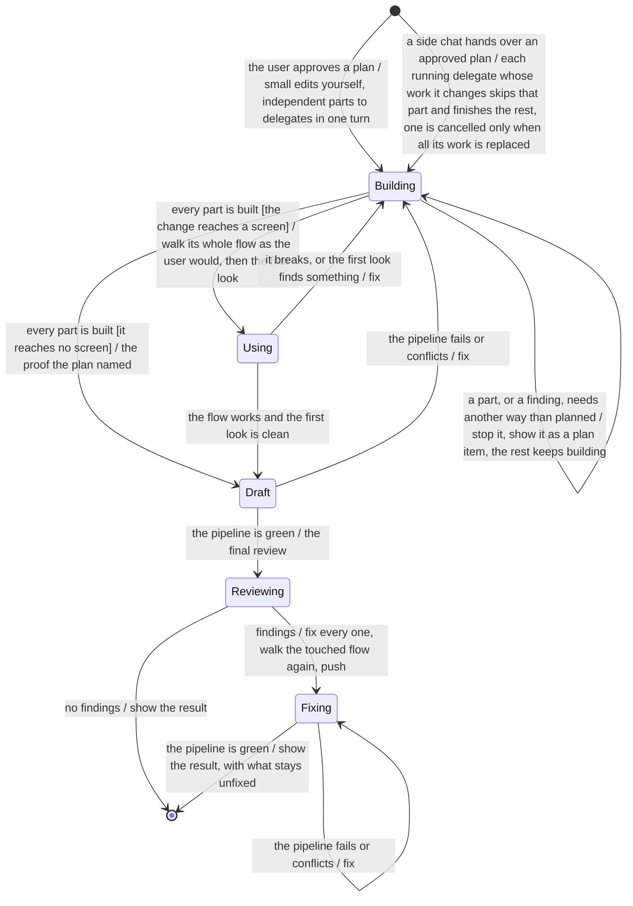

# Build



- **Using.** UI, and backend changes a screen shows, in the T3 browser; native changes in the Device panel. This standing request covers the preview and device tools. The walk runs on a commit, and its proof holds while what it shows is unchanged.
- **First look.** A `reviewer` delegate that gets the running app and nothing else, neither diff nor plan.
- **Draft.** The package checks `AGENTS.md` names, the fixer, a commit, a push and a draft PR, by [pull-requests](references/pull-requests.md), read before the first commit.
- **Final review.** Once, when nothing can still change: one `reviewer` delegate per PR in one turn, each given the plan, its prototype's path and the PR, and one more over the whole stack as one diff when it has several PRs.

## Delegates

| Work                                                                                                               | Model               |
| ------------------------------------------------------------------------------------------------------------------ | ------------------- |
| Edits whose architecture is settled; the browser, the emulator, captures, the first look; open research; long runs | GPT-6.2 Sol         |
| Bounded reads, searches, runs and checks                                                                           | GPT-6.1 Terra       |
| UI code; removals, since Codex rejects `rm -f` and `rm -rf`                                                        | Sonnet 5.5          |
| Work that cannot be scoped                                                                                         | Opus 5.5            |
| The final review                                                                                                   | GPT-6.2 Sol at high |
| Never, outside a council                                                                                           | Luna, Haiku         |

- **Effort.** Medium unless the table says high.
- **Split.** Small edits and reads stay with you. A delegate gets one whole outcome on files no other touches, coupled edits together, in your worktree and branch; a long burst of reading or browsing is one too.
- **Brief.** About 1,500 characters, since the delegate has the prompt, the skills and the checkout but not the thread. Its first line names its skill: `builder` to edit, `reviewer` for a first look or a final review, none for a read, an advisor or a council member.

  ```text
  Load the `builder` skill.

  Objective: Scope's trace rows show the build number for GitHub runs.
  Decisions: the label comes from the run's span whichever event arrives last; the fallback to the trace id stays.
  Prototype: /abs/path/scope-traces.html, variant b.
  Yours: apps/scope/src/services/telemetry/service.ts:480-520. Leave lib/telemetry.ts alone.
  Proof: the output of `vp -C apps/scope run test`.
  ```

- **Reports.** `PASS`: read its diff. `ISSUES`: resume it once with what the brief left out, then finish it yourself. `BLOCKED`: clear it and resume, or report it with the user's action.
