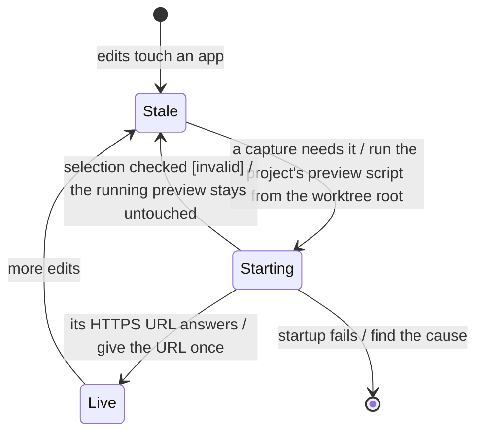

# Environment

Two headless Debian workers, a MacBook and an iPhone in one tailnet.

| Name          | Address          | Role                                                                       |
| ------------- | ---------------- | -------------------------------------------------------------------------- |
| `desktop`     | `100.97.120.3`   | Fastest; sometimes off                                                     |
| `dev`         | `100.68.201.107` | Always on: Deslop apps for `*.mp281x.xyz`                                  |
| `macbook-pro` | `100.115.207.60` | The user's control plane, the iOS Simulator and a Deploy worker, on demand |
| `iphone`      | `100.117.217.10` | T3 client only                                                             |

- **Names.** MagicDNS short names; `<name>.tailnet-8c4c.ts.net` has HTTPS certificates. SSH as `mp281x@dev`, `mp281x@desktop`, `matteopaludgnach@macbook-pro`.
- **Tools.** `vp` and `vpx` on `PATH`, also over SSH; `gh`, `glab` and the MCP gateway signed in.
- **Scratch.** Use the harness's session scratch directory when it provides one; otherwise `/tmp/<task>/`.
- **Git refs.** T3 checkpoints under `refs/t3/`; search history with `--branches --remotes`.
- **Auxiliary services.** Run task-local ones as temporary containers, not installs on the worker.
- **Agent MCP.** [Keyring and MCP](references/maintenance.md#keyring-and-mcp).

| Reference                                | For                                                      |
| ---------------------------------------- | -------------------------------------------------------- |
| [Deslop](references/deslop.md)           | Production, Stash data, npm, Apple and EAS, tracing      |
| [Dual](references/dual.md)               | Accounts, merges, preview, Jira, Google, VPN, tracing    |
| [Maintenance](references/maintenance.md) | Workers, setup, agent links, T3 settings, updates, clean |
| [Repositories](references/repos.md)      | The packages we use and reference repositories           |

## Previews

One per worktree: the systemd user unit `preview-<worktree name>`, shared over tailnet HTTPS.

- **Script.** Read the saved one with `t3_project_read`; maintenance removes a gone worktree's unit. Deslop's selects a changed web app, else Portfolio; `PREVIEW_APP=<app>` previews another app of the same change. The repository's own preview command or a background task bypasses the unit and dies with the turn.
- **Webhooks.** Funnel exposes a whole port: pick a free one of 443, 8443, 10000 and run `sudo tailscale funnel --bg --https=<port> --set-path <path> http://127.0.0.1:<api port><path>`; remove it with `... --set-path <path> off`.

## Tools

| Question                        | Tool                                                                                                                                        |
| ------------------------------- | ------------------------------------------------------------------------------------------------------------------------------------------- |
| Runtime state                   | Deploy's `list_apps` or `read_resource_history`, with the full worker name (`dev.mp281x.xyz`); host checks follow the maintenance reference |
| Runtime error, trace or latency | Scope's `list_operations`, then `search_traces`, then `read_trace` or `measure_latency`                                                     |
