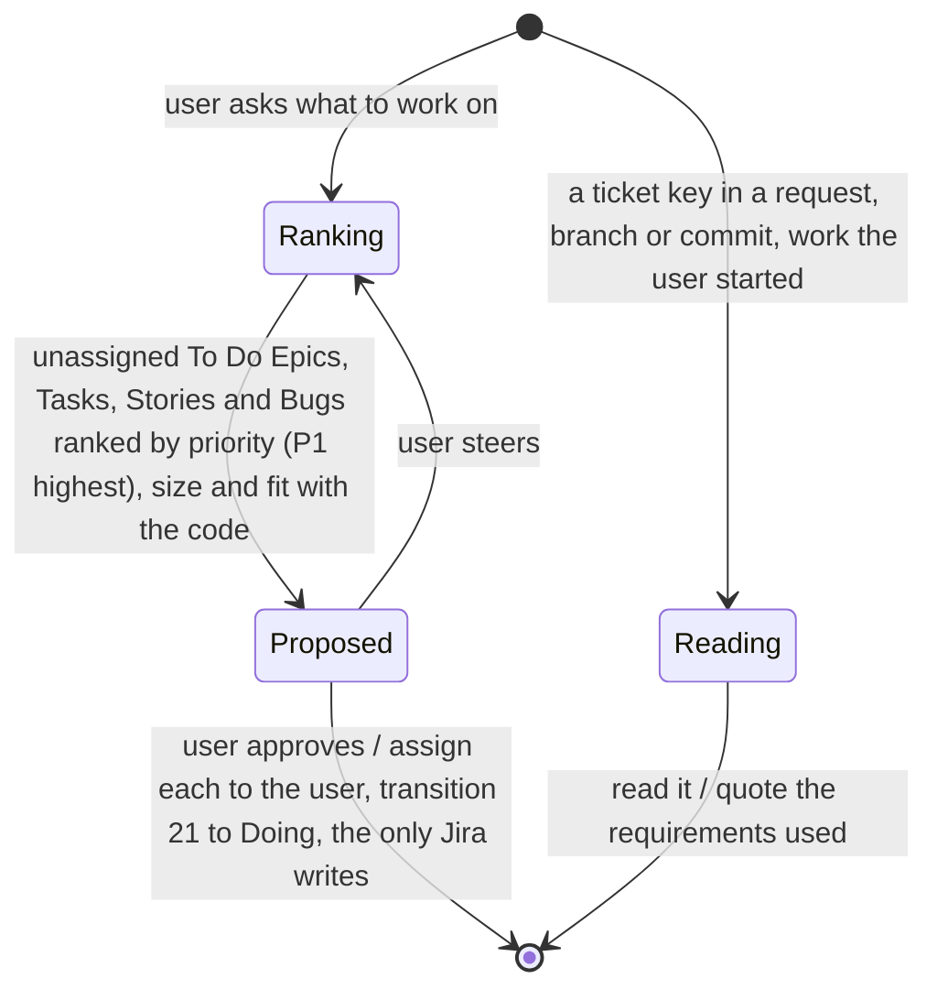
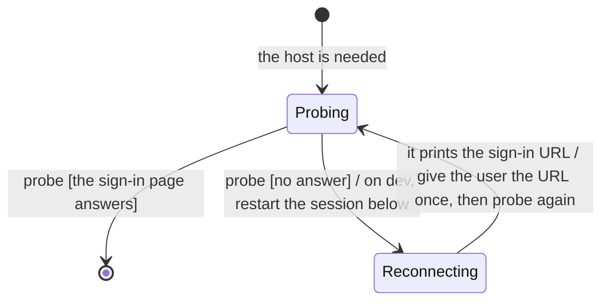

# Dual

`~/dual` is the code, its `CONTEXT.md` the domain terms and its README the local setup.

## Facts

- **Production.** One instance; a deployment stops and starts it, with no rolling overlap.
- **Organizations.** One company each: B2B, no self sign-up. Names, ids and icons are visible to everyone in it. Access protects contents (prompts, steps, sub-workflow structure, Skill and Knowledge Base contents, Connection secrets); lists show only what you were given, and opening something without access says so.
- **Dependencies.** Sharing lends them only during a run: a Workflow's Connection works inside it, nowhere else, and never appears as yours.
- **Deploy sharing.** Grants Use: running it and seeing your own Runs.
- **Spaces.** Nesting is visual, never permission. Nobody requests access; someone invites you.
- **Migrations.** Model changes ship as one lossless database migration, with no runtime path for old data.

## Workers

- **Accounts.** Writes go only to GitHub `MP281X`, GitLab `matteopaludgnach` and the user's Discord test channel. Saved preview tokens are read-only; write tokens come from `gh auth token` and the `glab` configuration.
- **Merge requests.** Squash-merged, stacks included; the source branch is deleted on merge.
- **Preview.** T3's `preview` script runs `bun run preview` and prints its URL; `settle` destroys its data.
- **Webhooks.** Funnel `/api/webhooks` to the preview port, which proxies `/api` to the API.

## Jira

Project `DOS`, board 1053, `datapizza.atlassian.net`; the user's account ID `712020:87e4f57e-6b5d-40ab-8dfa-faf159ead71a`.

- **Tools.** Dual's MCP `execute` (`dualos__execute` through the gateway), which finds its own tools (`atlassian-api.*`), never `acli`. Access is a service account: `currentUser()` and `@me` are not the user, so name the account ID. `To Do` is `status = "To Do"` (`statusCategory` also returns Backlog); `Doing` is transition `21`. A slow or confusing step is a Dual defect for the final reply.
- **Link.** `https://datapizza.atlassian.net/browse/<key>`.



## Google

The same `execute` reads, never writes, the user's work calendar and mail, `matteopaludgnach@datapizza.tech` (`google-api.*`, calendar `primary`), in `Europe/Rome`. Its sandbox has no `Intl`: convert by the zone's offset.

## VPN

`git.datapizza.tech` works only through dev's VPN route.



```bash
curl -fsS --max-time 5 https://git.datapizza.tech/users/sign_in >/dev/null || {
  openvpn3 session-manage --config datapizza --disconnect
  openvpn3 session-start --config datapizza --background
  # right after the start it prints "No sessions requires authentication interaction"
  timeout 55 bash -c 'until openvpn3 session-auth | rg -o "https://\S+"; do sleep 1; done'
}
```

## Tracing

- **Preview.** Exports nothing: trace a development launch.
- **Startup timestamp.** Fresh at every launch, so a restarted service hides its previous traces.
- **PostHog marker.** Nonempty enables the exporter, which Scope ignores; production PostHog configuration stays.

After `vp run build:runtime` at the root, from `packages/saas` with its development environment configured:

```bash
OTEL_RESOURCE_ATTRIBUTES="scope.runtime=server,scope.run.started_unix_nano=$(date +%s%N)" \
POSTHOG_PROJECT_TOKEN=scope-dev POSTHOG_OTLP_BASE_URL=https://scope.mp281x.xyz \
bun --env-file .env src/dev.ts api
# Use the same launch environment with `src/dev.ts worker` for the worker.
```
