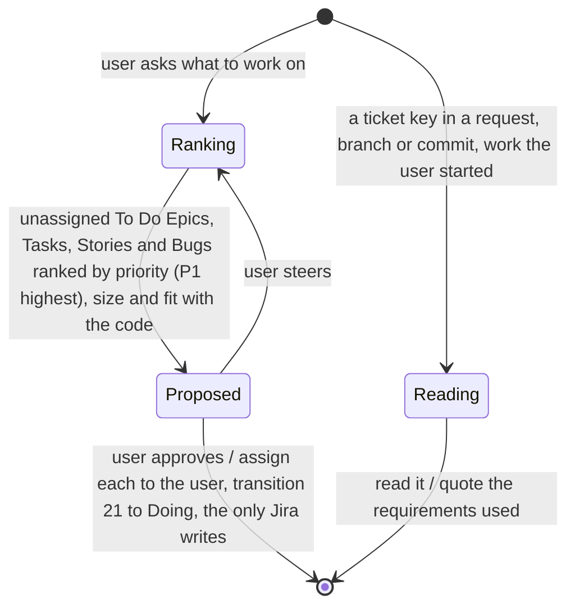
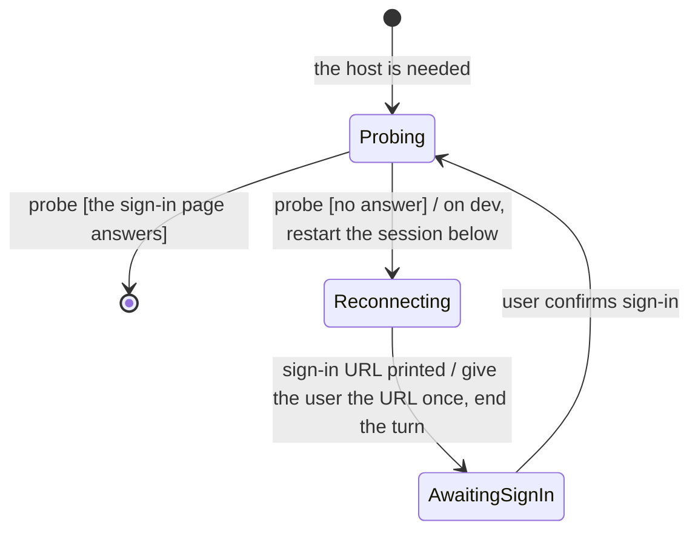

# Dual

The code is GitLab `dual/dual` on `git.datapizza.tech`.

## Accounts

Writes go only to GitHub `MP281X`, GitLab `matteopaludgnach` and the user's Discord test channel. Saved preview tokens are read-only; write tokens come from `gh auth token` and the `glab` configuration.

## AWS

The `aws` CLI is only for Dual's resources, and read-only: never create, change, delete, start, stop or invoke anything, whatever the role allows. Leave the account's other projects alone. Its default profile is the user's SSO role `DualosOperator` on account `datapizzadevprod`, region `eu-south-1`. An expired session needs `aws sso login --sso-session datapizza --use-device-code --no-browser`: give the user the autofill URL once and end the turn.

## Jira

Project `DOS`, board 1053, `datapizza.atlassian.net`; the user's account ID `712020:87e4f57e-6b5d-40ab-8dfa-faf159ead71a`.

- **Tools.** Dual's MCP `execute` (`dualos__execute` through the gateway), which finds its own tools (`atlassian-api.*`), never `acli`. Access is a service account: `currentUser()` and `@me` are not the user, so name the account ID. `To Do` is `status = "To Do"` (`statusCategory` also returns Backlog). A slow or confusing step is a Dual defect for the final reply.
- **Link.** `https://datapizza.atlassian.net/browse/<key>`.



## Google

The same `execute` reads, never writes, the user's work calendar and mail, `matteopaludgnach@datapizza.tech` (`google-api.*`, calendar `primary`), in `Europe/Rome`. Its sandbox has no `Intl`: convert by the zone's offset.

## VPN



```bash
curl -fsS --max-time 5 https://git.datapizza.tech/users/sign_in >/dev/null || {
  openvpn3 session-manage --config datapizza --disconnect
  openvpn3 session-start --config datapizza --background
  # right after the start it prints "No sessions requires authentication interaction"
  timeout 55 bash -c 'until openvpn3 session-auth | rg -o "https://\S+"; do sleep 1; done'
}
```

## Tracing

Add this to a development API or worker launch's environment to send it to Scope; production PostHog configuration stays:

```bash
OTEL_RESOURCE_ATTRIBUTES="scope.runtime=server,scope.run.started_unix_nano=$(date +%s%N)" \
POSTHOG_PROJECT_TOKEN=scope-dev POSTHOG_OTLP_BASE_URL=https://scope.mp281x.xyz
```
