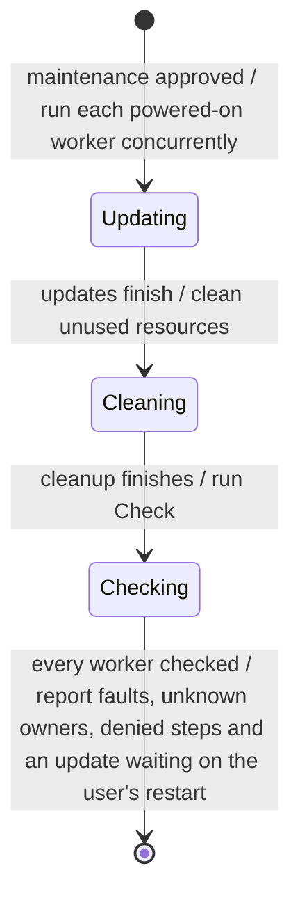
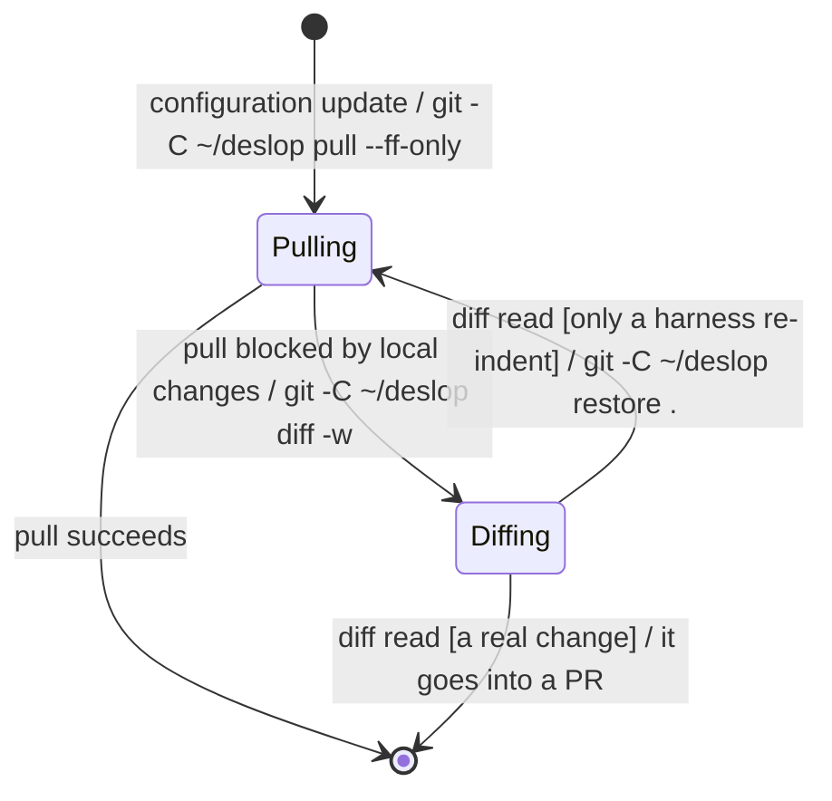
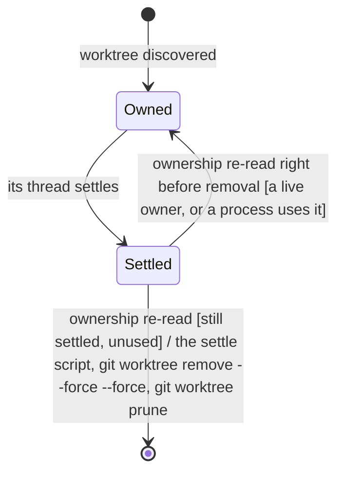
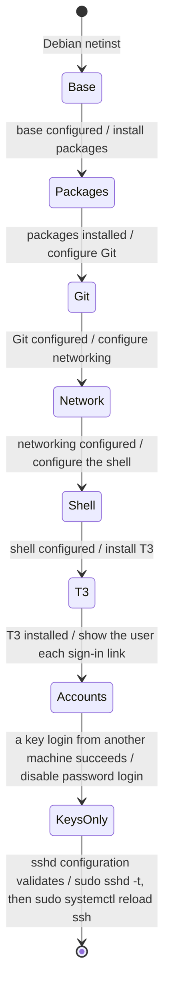
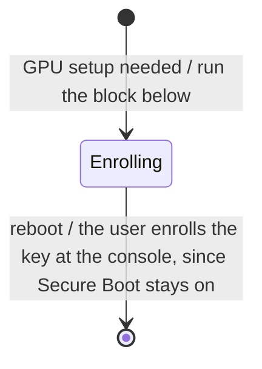

# Maintenance

A pass runs under the approved maintenance scope; removals go to a Sonnet delegate, since Codex rejects `rm -rf`:



- **The user's.** `t3 update`, `t3 doctor --fix`, `t3 service restart` and reboots; a pending T3 update is never reported.
- **Never touch** history (T3's databases and logs, `~/.claude/projects`, `~/.codex/sessions`), credentials, production data, running jobs or worktrees of running threads.

## Update

| Target          | Action                                                                                                                                                                                                                                                  |
| --------------- | ------------------------------------------------------------------------------------------------------------------------------------------------------------------------------------------------------------------------------------------------------- |
| Debian packages | `sudo apt-get update`, `sudo apt-get upgrade -y`, `sudo apt-get autoremove -y`, `sudo apt-get clean`; `vp upgrade`; `gh extension upgrade --all`.                                                                                                       |
| glab            | When `curl -fsSL https://gitlab.com/api/v4/projects/gitlab-org%2Fcli/releases/permalink/latest` names a newer `tag_name`, download `https://gitlab.com/gitlab-org/cli/-/releases/<tag>/downloads/glab_<version>_linux_amd64.deb` and `sudo dpkg -i` it. |
| Mac             | `vp upgrade`; label a pending macOS update from `softwareupdate -l`.                                                                                                                                                                                    |
| T3 CLI          | `vp install -g t3@nightly`; the service updates from T3's UI.                                                                                                                                                                                           |



## Clean

A refusal or failure skips only its step. A thread owns a worktree through `worktreePath` in `orchestration_v2_projection_threads.payload_json`, delegated children through `lineage.rootThreadId`; `settledAt`, `archived_at` or `deleted_at` settles it.

| Target          | Guard and action                                                                                                                                                                                                                                                                                                                                                                                                                                                  |
| --------------- | ----------------------------------------------------------------------------------------------------------------------------------------------------------------------------------------------------------------------------------------------------------------------------------------------------------------------------------------------------------------------------------------------------------------------------------------------------------------- |
| Tool caches     | When unused, `rm -rf ~/.cache/{ms-playwright,node-gyp,puppeteer,google-chrome-for-testing-headless} ~/.npm/_npx`.                                                                                                                                                                                                                                                                                                                                                 |
| Claude versions | Remove `~/.local/share/claude/versions/<version>` except the one `claude --version` reports.                                                                                                                                                                                                                                                                                                                                                                      |
| T3 versions     | Skip while `~/.t3/runtime/service-state.json` shows an uncommitted update. Keep `activeVersion`, the launcher named in `~/.config/systemd/user/t3code.service`'s `ExecStart`, and newer versions under `~/.t3/runtime/versions`.                                                                                                                                                                                                                                  |
| Docker          | When no Docker or Compose build runs, `docker image prune -a -f` and `docker builder prune -a -f`; never `docker system prune`.                                                                                                                                                                                                                                                                                                                                   |
| pnpm            | When no install runs, `pnpm store prune`.                                                                                                                                                                                                                                                                                                                                                                                                                         |
| Previews        | For gone worktrees, run Alchemy's `preview:destroy`, remove stopped `preview-*` units and their containers, and stop their surviving Dual `dualos-local-*-wt-<hash>` Postgres and OpenSandbox containers. `docker stop` preserves seed data; Dual's `settle` destroys it. Remove Deploy's `dual-preview.mp281x.xyz` exposure only when no preview answers behind it. Remove leftover `testcontainers-ryuk-*` and finished test runs' unnamed Postgres containers. |
| Local branches  | In `~/deslop` and `~/dual`, `git branch -D` only for branches no worktree checks out, never the default branch.                                                                                                                                                                                                                                                                                                                                                   |
| Remote branches | Use the block below only for merged or closed PRs whose head equals the branch tip, whose nonempty commit list is entirely the user's, and whose branch no thread uses. A failed query keeps the branch.                                                                                                                                                                                                                                                          |
| Mac caches      | Keep active Claude, Node and Vite+ versions; use the Mac block below.                                                                                                                                                                                                                                                                                                                                                                                             |



Remote branches:

```bash
git fetch -q --prune origin
for b in $(git for-each-ref --format='%(refname:lstrip=3)' refs/remotes/origin | grep -vx 'HEAD\|main\|master'); do
  if git remote get-url origin | grep -q github.com; then
    pr=$(gh pr list --head "$b" --state all --json state,commits,headRefOid -q '.[0]') || continue
    s=$(jq -r '.state // empty' <<<"$pr"); h=$(jq -r '.headRefOid // empty' <<<"$pr"); a=$(jq -r '[.commits[].authors[].email] | unique | join(" ")' <<<"$pr")
  else
    mr=$(glab mr list --source-branch "$b" --all -F json | jq '.[0]') || continue
    s=$(jq -r '.state // empty' <<<"$mr"); h=$(jq -r '.sha // empty' <<<"$mr"); a=$(glab api "projects/:id/merge_requests/$(jq -r .iid <<<"$mr")/commits" | jq -r '[.[].author_email] | unique | join(" ")')
  fi
  case "$s" in MERGED|CLOSED|merged|closed) ;; *) continue ;; esac
  [ "$h" = "$(git rev-parse "origin/$b")" ] && [ "$a" = "$(git config user.email)" ] || continue
  git worktree list --porcelain | grep -qx "branch refs/heads/$b" || git push -q origin --delete "$b"
done
```

Mac caches:

```bash
find ~/Library/Caches -maxdepth 1 -type d \( -iname '*updater*' -o -name '*.ShipIt' -o -name 'com.apple.Safari*' -o -name 'com.t3tools.t3code*' \) -exec rm -r -- {} +
rm -rf ~/Library/Caches/Google/Chrome ~/.cache/codex-runtimes "$HOME/Library/Application Support"/t3code*/{Cache,"Code Cache"}
```

## Check

Every pass:

- **Disk.** `df -h` and `df -i` per disk mount; `du -xhd1` under the home, `/var/lib` and `/tmp`; `sudo lsof -l +L1 -nP` for deleted-but-open files.
- **Ports.** `ss -ltnp`: name each listener's unit or container. A container published on `0.0.0.0` other than Minecraft's 25565 is a fault.
- **Units.** `systemctl --failed` and `systemctl --user --failed` empty.
- **Agents.** `find ~/.claude/settings.json ~/.claude/agents/pair.md ~/.claude/skills ~/.codex/config.toml ~/.codex/instructions.md ~/.codex/rules/deny.rules ~/.codex/skills/* -maxdepth 0 ! -type l` prints only `~/.codex/skills/.system`; `find -L ~/.claude/skills ~/.codex/skills -maxdepth 1 -type l` prints nothing; `~/deslop` is clean on current `main`.
- **T3.** `t3 --version` equals `activeVersion`; `t3 doctor --base-dir ~/.t3 --dry-run` prints "Nothing to repair"; `t3 connect status` ends "✓ Other devices can reach this machine".
- **sshd.** `sudo sshd -T` shows `usepam yes`, `passwordauthentication no`, `permitrootlogin no`.
- **VPN.** `git -C ~/dual ls-remote -q origin HEAD` succeeds; otherwise reconnect by Dual's **VPN**.
- **GPU.** desktop, after kernel or driver updates: `nvidia-smi` lists the RTX 5070 and `sudo modinfo -F version nvidia` matches it.

## Setup and repair

### Debian worker



| State    | Commands                                                                                                                                                                                                                                                                                                                                                |
| -------- | ------------------------------------------------------------------------------------------------------------------------------------------------------------------------------------------------------------------------------------------------------------------------------------------------------------------------------------------------------- |
| Base     | Passwordless sudo in `/etc/sudoers.d/99-mp281x-nopasswd` (0440); install `sudo`, `network-manager`, `ufw`; `printf 'D /tmp 1777 root root 7d\n' \| sudo tee /etc/tmpfiles.d/tmp.conf && sudo systemctl mask tmp.mount`                                                                                                                                  |
| Packages | Docker, `gh`, `glab`, `unattended-upgrades`, ripgrep, jq, sqlite3, btop; `mp281x` in `docker`; `/etc/docker/daemon.json`: `{"live-restore": true, "ip": "127.0.0.1", "default-network-opts": {"bridge": {"com.docker.network.bridge.host_binding_ipv4": "127.0.0.1"}}}`; desktop: `/etc/apt/apt.conf.d/99force-ipv4` holds `Acquire::ForceIPv4 "true";` |
| Git      | `rebase.updateRefs`, `rebase.autoSquash`, `rebase.autoStash`, `push.autoSetupRemote`, `fetch.prune`, `rerere.enabled` true; `diff.algorithm histogram`, `merge.conflictStyle zdiff3`, `init.defaultBranch main`; [identity](#git-identity)                                                                                                              |
| Network  | dev: `openvpn3 config-import --config <datapizza.ovpn> --name datapizza --persistent`; the block below; then, over the tailnet, `ufw default deny incoming`, dev allowing TCP 80, 443, 25565 and UDP 443                                                                                                                                                |
| Shell    | `loginctl enable-linger mp281x`; Vite+ with `VP_HOME="$HOME/.vite-plus"`, Claude Code; `~/.bashrc`'s first lines put `$HOME/.local/bin:$HOME/.vite-plus/bin` on `PATH`; `~/.config/pnpm/config.yaml`: `minimumReleaseAgeExclude: ["@deslop/*"]`                                                                                                         |
| T3       | `vp install -g t3@nightly`, `t3 service install`, `t3 connect link --headless`, `t3 connect publish`, `t3 browser setup`, `sudo hostnamectl set-hostname --pretty <name>`                                                                                                                                                                               |
| Accounts | `gh auth login`, `glab auth login --hostname git.datapizza.tech`, `claude auth login`, `codex login --device-auth`; `gh auth setup-git`, `gh extension install github/gh-stack`; clone both repositories; `t3 project add --title <name> <path>`; [agent links](#agent-configuration-links), [keyring and MCP](#keyring-and-mcp)                        |
| KeysOnly | `/etc/ssh/sshd_config.d/10-keys-only.conf`: `UsePAM yes`, `PasswordAuthentication no`, `KbdInteractiveAuthentication no`, `PermitRootLogin no`, `X11Forwarding no`                                                                                                                                                                                      |

```bash
curl -fsSL https://pkgs.tailscale.com/stable/debian/trixie.noarmor.gpg | sudo tee /usr/share/keyrings/tailscale-archive-keyring.gpg >/dev/null
curl -fsSL https://pkgs.tailscale.com/stable/debian/trixie.tailscale-keyring.list | sudo tee /etc/apt/sources.list.d/tailscale.list
sudo apt-get update && sudo apt-get install -y tailscale
openvpn3 configs-list 2>/dev/null | grep -q datapizza && R=$(getent ahostsv4 git.datapizza.tech | awk 'NR == 1 {print $1}')/32
sudo tailscale up --accept-routes --advertise-routes=$R
sudo tailscale set --operator=mp281x
```

### Agent configuration links

Also after a harness replaced a link with a file. `~/.codex/skills` stays a real folder for Codex's `.system`.

```bash
r=~/deslop
mkdir -p ~/.claude/agents ~/.codex/rules ~/.codex/skills
ln -sfn $r/.claude/settings.json ~/.claude/settings.json
ln -sfn $r/.claude/agents/pair.md ~/.claude/agents/pair.md
ln -sfn $r/.claude/skills ~/.claude/skills
find ~/.codex/skills -maxdepth 1 -type l -delete
ln -sfn ~/.claude/skills/* ~/.codex/skills/
ln -sfn $r/.codex/global-config.toml ~/.codex/config.toml
ln -sfn $r/.codex/instructions.md ~/.codex/instructions.md
ln -sfn $r/.codex/rules/deny.rules ~/.codex/rules/deny.rules
codex execpolicy check --rules ~/.codex/rules/deny.rules true
```

### T3 settings

Copy after a change, with `target=mp281x@<other worker>`.

```bash
q="SELECT project_id, workspace_root FROM projection_projects WHERE deleted_at IS NULL"
new=$(jq --argjson src "$(sqlite3 -readonly -json ~/.t3/userdata/statev2.sqlite "$q")" \
  --argjson dst "$(ssh "$target" "sqlite3 -readonly -json ~/.t3/userdata/statev2.sqlite '$q'")" \
  --argjson old "$(ssh "$target" 'cat ~/.t3/userdata/settings.json')" '
  ([$src[] | {key: .project_id, value: .workspace_root}] | from_entries) as $root
  | ([$dst[] | {key: .workspace_root, value: .project_id}] | from_entries) as $id
  | def remap: with_entries(select($id[$root[.key]] != null) | .key = $id[$root[.key]]);
  (. | del(.environmentIcon)) + ($old | {environmentIcon} | with_entries(select(.value != null)))
  | .projectSettingsOverrides |= ((. // {}) | remap)
  | .projectSettingsFolded |= ((. // {}) | if type == "object" then remap else . end)
' ~/.t3/userdata/settings.json) && ssh "$target" 'cat > ~/.t3/userdata/settings.json' <<<"$new"
```

Keep each project's `scripts` (`t3_project_update`) equal to `projectSettingsOverrides.<id>.defaultProjectScripts`; never edit `projectScriptOverrides`.

### Desktop GPU



```bash
curl -fsSLo /tmp/cuda-keyring.deb https://developer.download.nvidia.com/compute/cuda/repos/debian13/x86_64/cuda-keyring_1.1-1_all.deb
sudo dpkg -i /tmp/cuda-keyring.deb && sudo apt-get update
sudo apt-get install -y --no-install-recommends linux-headers-amd64 "linux-headers-$(uname -r)" nvidia-driver-cuda nvidia-kernel-open-dkms
sudo mokutil --import /var/lib/dkms/mok.pub  # password via request_secret, file delivery, twice on stdin
```

### Mac

`curl -fsSL https://vite.plus | bash`; `~/.zshenv` exports `PATH="$HOME/.local/bin:$HOME/.vite-plus/bin:$PATH"` and `DEVELOPER_DIR=/Applications/Xcode.app/Contents/Developer`. Xcode: `open "macappstore://apps.apple.com/app/id497799835"`.

### Keyring and MCP

```bash
sudo apt-get install -y gnome-keyring libsecret-tools
mkdir -p ~/.config/systemd/user ~/.local/share/dbus-1/services
printf '%s\n' '[Unit]' 'Description=Secret Service for headless CLI sign-ins' '[Service]' \
  "ExecStart=/bin/sh -c 'printf headless | exec /usr/bin/gnome-keyring-daemon --foreground --replace --unlock --components=secrets'" \
  'Restart=on-failure' '[Install]' 'WantedBy=default.target' > ~/.config/systemd/user/secret-service.service
printf '%s\n' '[D-BUS Service]' 'Name=org.freedesktop.secrets' 'Exec=/bin/false' 'SystemdService=secret-service.service' \
  > ~/.local/share/dbus-1/services/org.freedesktop.secrets.service
busctl --user call org.freedesktop.DBus / org.freedesktop.DBus ReloadConfig
systemctl --user daemon-reload && systemctl --user enable --now secret-service.service
claude mcp add --transport http --scope user gateway https://gateway.mp281x.xyz/mcp  # or codex; Auth names the worker's tailnet owner, so there is no login
```

### Git identity

```bash
mkdir -p ~/.config/git
printf '[user]\n\tname = MP281X\n\temail = dev@mp281x.xyz\n' > ~/.config/git/github.gitconfig
printf '[user]\n\tname = Matteo Paludgnach\n\temail = matteopaludgnach@datapizza.tech\n' > ~/.config/git/datapizza.gitconfig
for u in 'https://github.com/**' 'git@github.com:**' 'ssh://git@github.com/**'; do git config --global "includeIf.hasconfig:remote.*.url:$u.path" ~/.config/git/github.gitconfig; done
for u in 'https://git.datapizza.tech/**' 'git@git.datapizza.tech:**' 'ssh://git@git.datapizza.tech/**'; do git config --global "includeIf.hasconfig:remote.*.url:$u.path" ~/.config/git/datapizza.gitconfig; done
```
