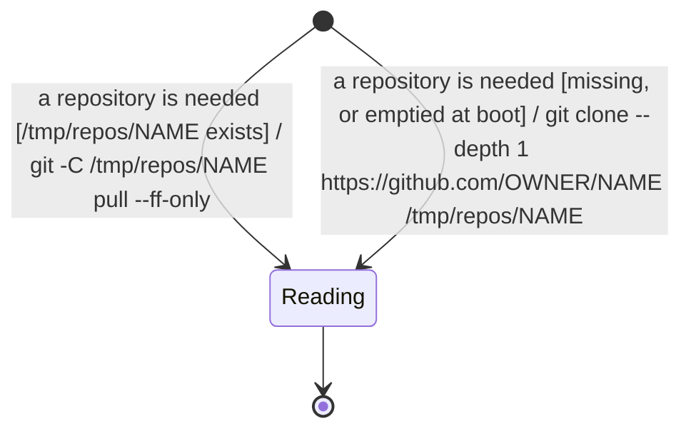

# Reference repositories

Pick the one whose subject matches; read its source, never a summary of it.

| Repository                                                                                                                                                    | Reference for                                       |
| ------------------------------------------------------------------------------------------------------------------------------------------------------------- | --------------------------------------------------- |
| [Effect-TS/effect](https://github.com/Effect-TS/effect)                                                                                                       | Effect APIs and atoms                               |
| [kitlangton/effect-solutions](https://github.com/kitlangton/effect-solutions)                                                                                 | Effect services                                     |
| [Effect-TS/skills](https://github.com/Effect-TS/skills)                                                                                                       | Agent knowledge of Effect                           |
| [pingdotgg/t3code](https://github.com/pingdotgg/t3code)                                                                                                       | Server and client contracts, RPC, MCP, Expo, web UX |
| [anomalyco/opencode](https://github.com/anomalyco/opencode)                                                                                                   | Architecture, agent loop, tools, permissions        |
| [UsefulSoftwareCo/executor](https://github.com/UsefulSoftwareCo/executor)                                                                                     | Plugin SDK, MCP hosts                               |
| [tim-smart/lalph](https://github.com/tim-smart/lalph)                                                                                                         | CLI, processes, cluster                             |
| [tim-smart/bunnings-lite](https://github.com/tim-smart/bunnings-lite)                                                                                         | App atoms                                           |
| [typeonce-dev/effect-machine](https://github.com/typeonce-dev/effect-machine)                                                                                 | State machines                                      |
| [shadcn-ui/ui](https://github.com/shadcn-ui/ui)                                                                                                               | Shipped components                                  |
| [google-labs-code/design.md](https://github.com/google-labs-code/design.md)                                                                                   | Design documents                                    |
| [Effect-TS/website](https://github.com/Effect-TS/website), [discord-bot](https://github.com/Effect-TS/discord-bot), [cafe](https://github.com/Effect-TS/cafe) | Whole Effect apps                                   |
| [mattpocock/skills](https://github.com/mattpocock/skills)                                                                                                     | Writing for agents                                  |
| [cursor/plugins](https://github.com/cursor/plugins)                                                                                                           | Skills that augment strong models                   |
| [anthropics/skills](https://github.com/anthropics/skills)                                                                                                     | Skill evaluation                                    |

## Clones

Read-only, in `/tmp/repos/<repository>`: never edit, commit or push there.

