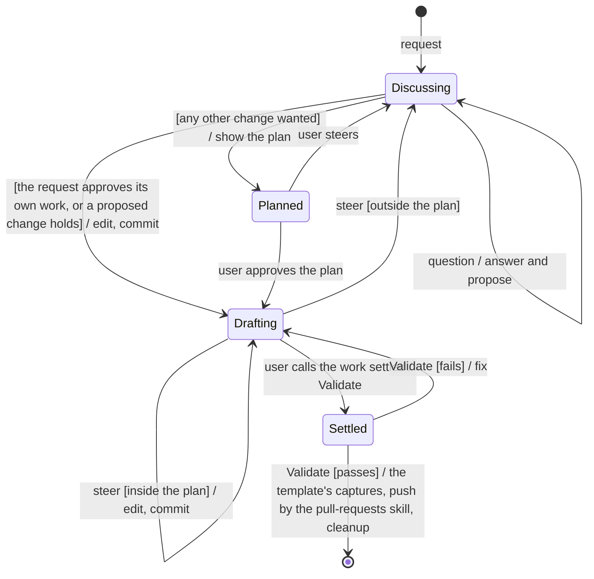
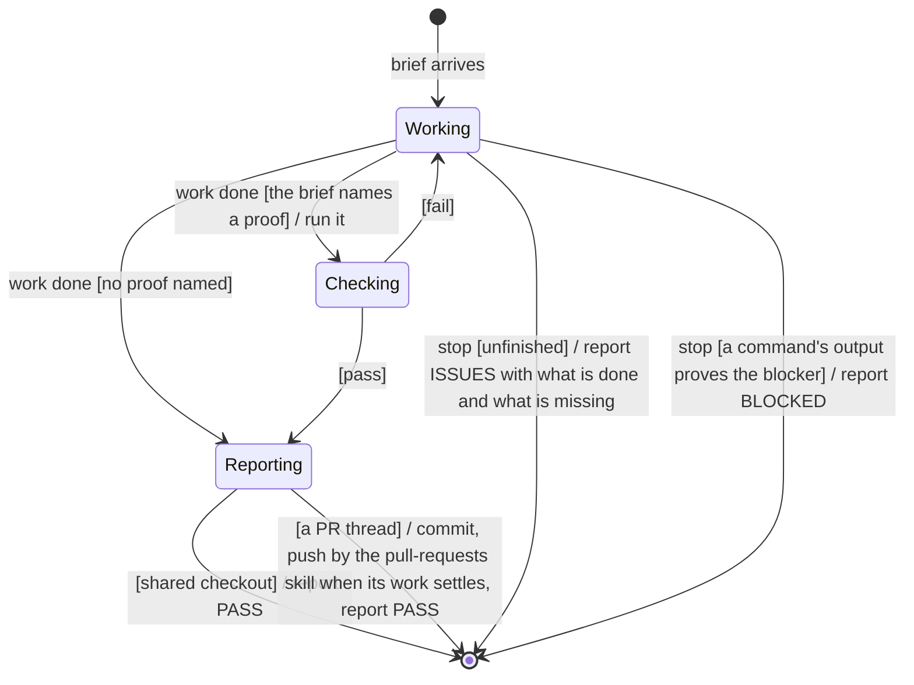

# Orchestrator

## Task

- **Checks wait for settle.** While drafting, the fixer, checks, tests and pushes wait for Validate unless the user asks; a diagnosis still runs its reproducing probe, and a delegate the proof its brief names.
- **Plan.** A UI plan is a rough HTML prototype, an architecture plan a diagram, made in minutes without the code reading a replica needs: 2–3 genuinely different directions you would build, side by side on the same data, without filters or captions; a better idea than the user's is one of them.
- **Precedent.** Before an edit, read how the neighbouring feature or shared package does it.
- **Outside code.** [Repositories](references/repos.md).
- **One owner.** One main thread per worktree: check `t3_thread_list` first and send evidence to a live owner.
- **Main.** Do small edits, prototypes and needed reads yourself, since a delegate costs a brief and a report on a thread that re-reads its context every call.

## Route

Claude is smarter in every respect; Codex is weaker but persists until it reaches a result, good or bad. The main thread runs on the Claude plan, the one to make last, so delegates go to Codex unless the work needs Claude's judgement.

| Work                                                                                                                                                         | Model                              | `target`                                                    |
| ------------------------------------------------------------------------------------------------------------------------------------------------------------ | ---------------------------------- | ----------------------------------------------------------- |
| Edits whose architecture is settled; browser and computer use, captures; deep reviews; unbounded exploration; long runs, since Codex's cache does not expire | GPT-6.1 Sol                        | `codex` / `gpt-6.1-sol`                                     |
| Bounded reads, searches, runs and checks                                                                                                                     | GPT-6.1 Terra                      | `codex` / `gpt-6.1-terra`                                   |
| UI code; removals, since Codex rejects `rm -f` and `rm -rf`                                                                                                  | Sonnet 5.5                         | `claudeAgent` / `claude-sonnet-5-5`                         |
| Work that cannot be scoped: an open UI or architecture                                                                                                       | Opus 5.5                           | `claudeAgent` / `claude-opus-5-5`                           |
| Advisors on a hard architectural decision, both in one turn                                                                                                  | Fable 5.2 and GPT-6.1 Sol at xhigh | `claudeAgent` / `claude-fable-5-2`, `codex` / `gpt-6.1-sol` |
| Never                                                                                                                                                        | Luna, Haiku                        |                                                             |

- **Other company, other view.** Models of one company think alike, like coworkers; the other company's model is an outsider. A review or second opinion comes from the company that did not write or propose the work; advisors come from both, for both views.
- **Effort.** Medium (`effort` on Claude, `reasoningEffort` on Codex); high when the task needs it; never low, nor xhigh or above outside the advisor row.

## Delegation

```mermaid
stateDiagram-v2
    [*] --> Running : outcome briefed / delegate_task; siblings with disjoint files in one turn
    Running --> [*] : diff matches the decisions / commit it
    Running --> Running : deliverable missing [first time] / fill the gap the brief left
    Running --> [*] : deliverable missing [again] / finish it in the main thread
    [*] --> PRThread : a separate PR must progress in parallel / delegate_task isolation 'worktree', a persistent thread
    PRThread --> PRThread : its next step / t3_thread_send
    PRThread --> [*] : its PR merged or closed
```

- **Shared checkout.** Delegates other than PR threads work in the main thread's worktree and branch; sharing one index, they never commit.
- **One outcome per delegate.** Coupled edits share one thread, since split halves come back for the main thread to reconcile. A procedure is a skill, not a child agent.
- **No handoff files.** Context travels in the brief and the report, never a file one side writes and the other reads.

## Brief

About 1,500 characters: the delegate already has the instructions, the skills and the checkout with its uncommitted edits, but not the thread; a PR thread's worktree starts at the parent's commit, without them. Give only the objective, the settled decisions, the files it owns, what to leave alone, the narrowest command that proves it, when one does, and the report you want. A task you cannot scope that tightly goes to Opus 5.5, never to a cheaper model.

## Delegate run

A delegate runs its brief as the approved plan, edits only the brief's files and starts no delegates.

- **Report.** Short: its status word, then evidence (command, exit code, `path:line`, and a SHA only for a commit it made), not narration.
