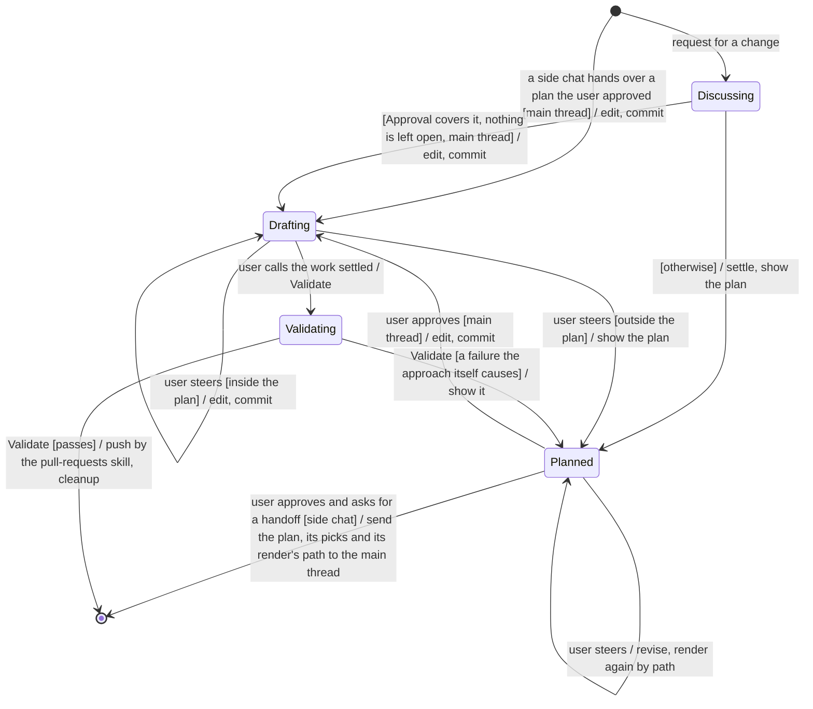
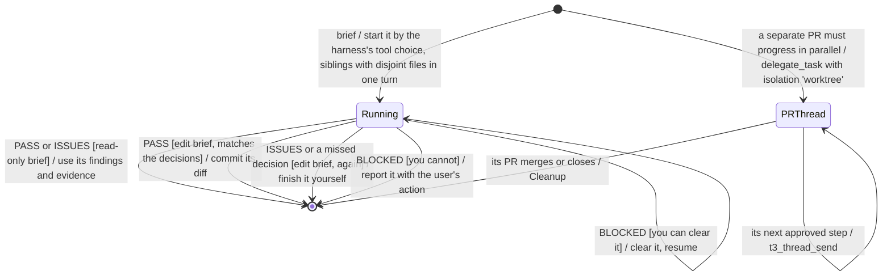
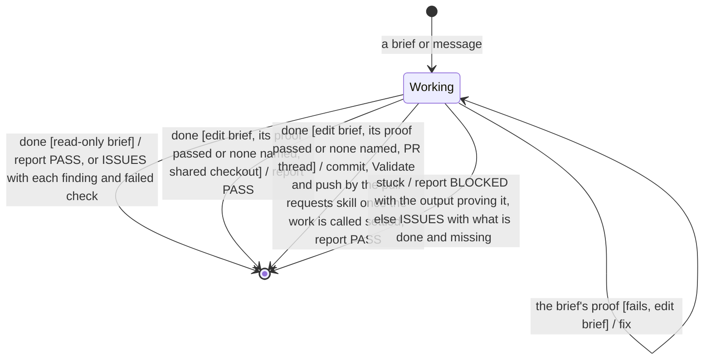

# Orchestrator

## Task

- **Settle.** Before showing a plan, answer from code, docs, tests or a probe each point it touches, leaving the user only taste, product and business knowledge recorded nowhere:
  - what deploys alone, and which service owns which data;
  - who may do what;
  - the queries, volume and retention that shape storage;
  - each piece of state's owner, lifetime and source copy;
  - each failure: a cancellation, a retry or the user's to act on, and where it is handled;
  - the operating facts that remove complexity.
- **Plan.** What changes and what stays untouched, each claim traced to code read or run. An open choice shows 2–3 variants you would build, rough, on the same data, differing in interaction model or structure rather than styling, a better idea than the user's among them. Each takes the format that leaves no ambiguity: UI in [prototype.html](references/prototype.html), by its header; structure as a traced value, a contract diff, a role-by-operation grid or sample rows before and after; never prose.
- **Shared patterns** are approved on one realistic page showing all their states before they spread.
- **Approved render.** The build matches the picked variant's screens, labels, states and click paths; a difference it needs goes back to the user as a plan.
- **Checks wait for settle.** While drafting, the fixer, checks, tests and pushes wait for Validate unless the user asks; a diagnosis still runs its probe, and a delegate the proof its brief names.
- **Precedent.** Before an edit, read how the neighbouring feature or shared package does it. A package's behaviour comes from its installed source, read rather than recalled; [Repositories](references/repos.md) for what neither answers.
- **One owner.** One main thread per worktree: check `t3_thread_list` first and give the user a live owner's link rather than starting a second.
- **Yourself.** Small edits, prototypes and reads, since a delegate costs a brief and a report.

## Route

Delegates go to Codex unless the work needs Claude's judgement: the main thread runs on the Claude plan, the one to make last, and Codex persists until it reaches a result, good or bad.

| Work                                                                                                                                                                     | Model                             | `target`                                                    |
| ------------------------------------------------------------------------------------------------------------------------------------------------------------------------ | --------------------------------- | ----------------------------------------------------------- |
| Edits whose architecture is settled; browser and computer use, captures; reviews of Claude's work; unbounded exploration; long runs, since Codex's cache does not expire | GPT-6.1 Sol                       | `codex` / `gpt-6.1-sol`                                     |
| Bounded reads, searches, runs and checks                                                                                                                                 | GPT-6.1 Terra                     | `codex` / `gpt-6.1-terra`                                   |
| UI code; removals, since Codex rejects `rm -f` and `rm -rf`                                                                                                              | Sonnet 5.5                        | `claudeAgent` / `claude-sonnet-5-5`                         |
| Work that cannot be scoped: an open UI or architecture                                                                                                                   | Opus 5.5                          | `claudeAgent` / `claude-opus-5-5`                           |
| Advisors on a hard architectural decision, both in one turn                                                                                                              | Fable 5.2 and GPT-6.1 Sol at high | `claudeAgent` / `claude-fable-5-2`, `codex` / `gpt-6.1-sol` |
| Never                                                                                                                                                                    | Luna, Haiku                       |                                                             |

- **Other company.** A review or second opinion comes from the company that did not write or propose the work.
- **Effort.** Medium (`effort` on Claude, `reasoningEffort` on Codex); high when the task needs it, and for advisors; never low, xhigh or above.

## Delegation

- **Shared checkout.** Delegates other than PR threads share the main thread's worktree and branch, so they never commit.
- **One outcome per delegate.** Coupled edits share one delegate. A procedure is a skill, not a child agent.
- **Brief.** About 1,500 characters, since the delegate has the instructions, skills and checkout but not the thread: the objective, the settled decisions, the approved render's path, the files it owns, what to leave alone, the narrowest command that proves it and the report you want.

## Delegate run

A delegate runs its brief as the approved plan and edits only its files.

- **Report.** Its status word, then evidence: command, exit code, `path:line`, and a SHA only for a commit it made.
