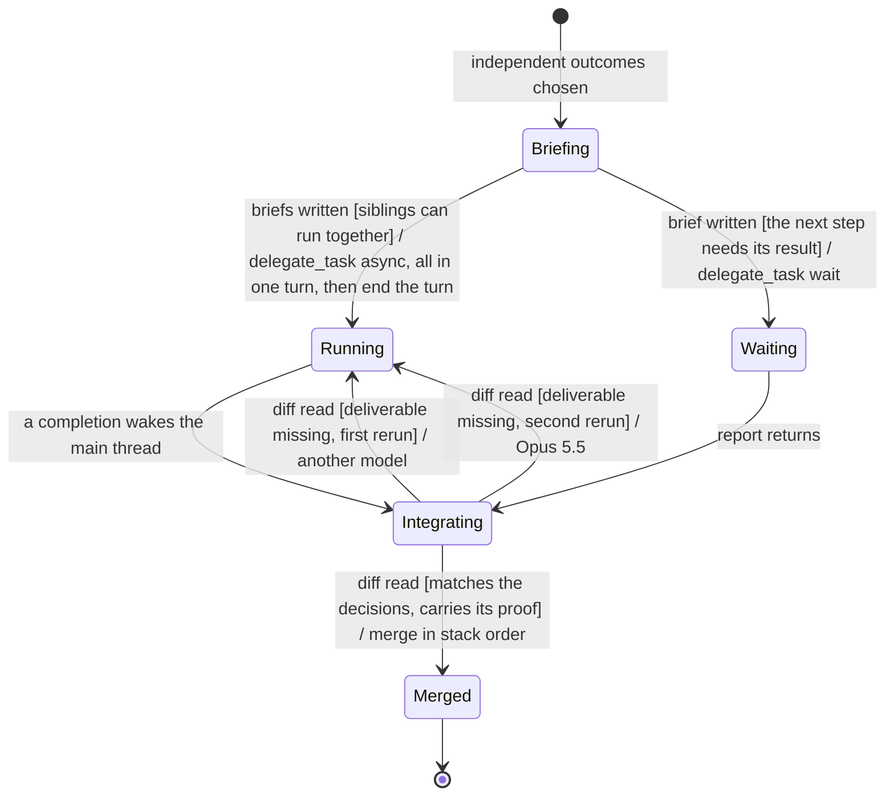

# Orchestrator

## Route

The user picks the main thread's model and effort; this table routes delegates.

| Work                                                   | Model         | `target`                            |
| ------------------------------------------------------ | ------------- | ----------------------------------- |
| Default: edits, browser walks, research, captures      | GPT-6.1 Sol   | `codex` / `gpt-6.1-sol`             |
| Long or overnight runs (Codex's cache does not expire) | GPT-6.1 Sol   | `codex` / `gpt-6.1-sol`             |
| UI code, quick reads                                   | Sonnet 5.5    | `claudeAgent` / `claude-sonnet-5-5` |
| Removals (Codex rejects `rm -f` and `rm -rf`)          | Sonnet 5.5    | `claudeAgent` / `claude-sonnet-5-5` |
| A build whose UI or architecture is still open         | Opus 5.5      | `claudeAgent` / `claude-opus-5-5`   |
| Only when the user picks it                            | Fable 5.2     | `claudeAgent` / `claude-fable-5-2`  |
| Trial: bounded reads, searches, runs and checks        | GPT-6.1 Terra | `codex` / `gpt-6.1-terra`           |
| Never                                                  | Luna, Haiku   |                                     |

- **Trial.** Compare Terra's reports with Sol's before it becomes a default.
- **Effort.** Medium (`effort` on Claude, `reasoningEffort` on Codex); high when the task needs it; never low, xhigh or above.

## Run

- **One outcome per delegate.** Coupled edits share one thread, since split halves come back for the main thread to reconcile. A procedure is a skill, not a child agent.
- **One owner per file.** No sibling touches a delegate's files, so siblings merge without conflicts.
- **Worktrees.** A writing delegate works and commits in its own worktree (`isolation: 'worktree'`); read-only delegates share the checkout.
- **Surveys** run once; save the result to a file outside the checkout and cite its path in later briefs.
- **Reruns** carry only what was missing.
- **Integrate** from the diff against the decisions, not the summary; a missing proof is a gap, not a pass.

## Brief

About 1,500 characters: the delegate already has the instructions, the skills and the repository at the parent's commit, but not the thread or uncommitted edits. Give only the objective, the settled decisions, the files it owns, what to leave alone, the command that proves it done and the report you want.
