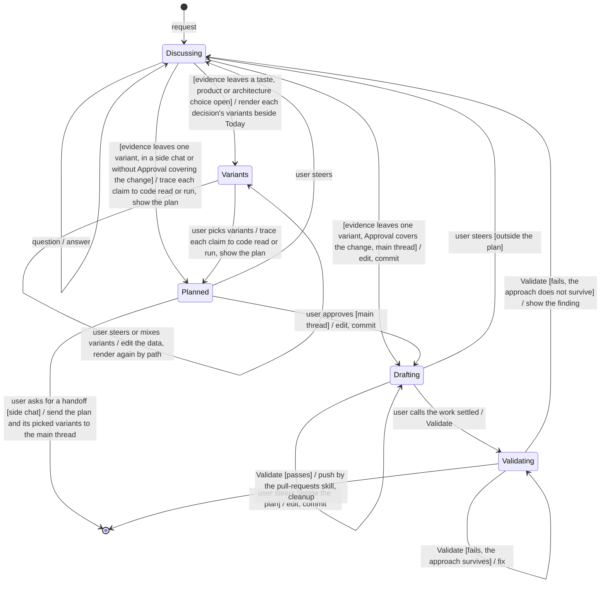
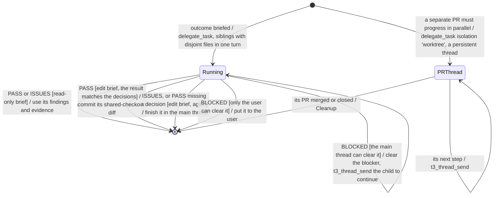
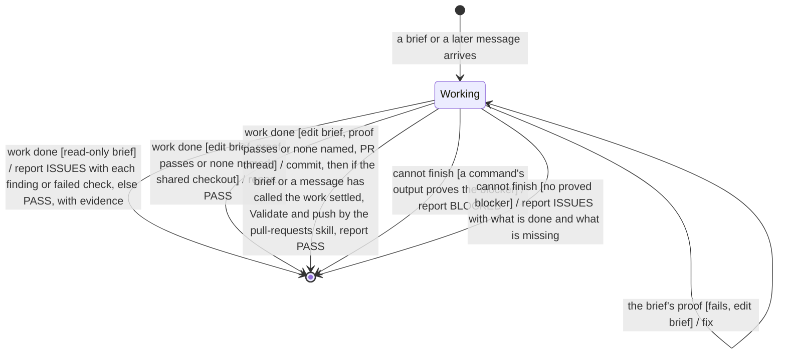

# Orchestrator

## Task

- **Checks wait for settle.** While drafting, the fixer, checks, tests and pushes wait for Validate unless the user asks; a diagnosis still runs its reproducing probe, and a delegate the proof its brief names.
- **Variants.** Rough, made in minutes before any build: 2–3 you would build, differing in interaction model rather than styling, on the same data; a better idea than the user's is one of them.
- **UI.** [prototype.html](references/prototype.html), by its header. A pattern several screens share is approved on one realistic page showing all its states before it spreads.
- **Architecture.** Settle first, each from code, docs, tests or a probe where they answer it: what deploys alone and who owns which data; who may do what; which queries, volume and retention shape storage; where each piece of state lives, how long, and which copy is the source; whether a failure is a cancellation, a retry or the user's to act on, and where it is handled; which operating facts remove complexity. Each variant then shows, under its id, the format that leaves no ambiguity for its case (a traced value, a contract diff, a role-by-operation grid, sample rows before and after), never prose, with only the details that change the choice.
- **Untouched.** Every plan lists what stays untouched beside what changes.
- **Precedent.** Before an edit, read how the neighbouring feature or shared package does it.
- **Outside code.** A package's behaviour comes from its installed source, read rather than recalled; [Repositories](references/repos.md) only for what local precedent and installed source cannot answer.
- **One owner.** One main thread per worktree: check `t3_thread_list` first and give the user a live owner's link rather than starting a second.
- **Main.** Do small edits, prototypes and needed reads yourself, since a delegate costs a brief and a report on a thread that re-reads its context every call.

## Route

Delegates go to Codex unless the work needs Claude's judgement: the main thread runs on the Claude plan, the one to make last, and Codex persists until it reaches a result, good or bad.

| Work                                                                                                                                                         | Model                              | `target`                                                    |
| ------------------------------------------------------------------------------------------------------------------------------------------------------------ | ---------------------------------- | ----------------------------------------------------------- |
| Edits whose architecture is settled; browser and computer use, captures; deep reviews; unbounded exploration; long runs, since Codex's cache does not expire | GPT-6.1 Sol                        | `codex` / `gpt-6.1-sol`                                     |
| Bounded reads, searches, runs and checks                                                                                                                     | GPT-6.1 Terra                      | `codex` / `gpt-6.1-terra`                                   |
| UI code; removals, since Codex rejects `rm -f` and `rm -rf`                                                                                                  | Sonnet 5.5                         | `claudeAgent` / `claude-sonnet-5-5`                         |
| Work that cannot be scoped: an open UI or architecture                                                                                                       | Opus 5.5                           | `claudeAgent` / `claude-opus-5-5`                           |
| Advisors on a hard architectural decision, both in one turn                                                                                                  | Fable 5.2 and GPT-6.1 Sol at xhigh | `claudeAgent` / `claude-fable-5-2`, `codex` / `gpt-6.1-sol` |
| Never                                                                                                                                                        | Luna, Haiku                        |                                                             |

- **Other company.** A review or second opinion comes from the company that did not write or propose the work; advisors come from both.
- **Effort.** Medium (`effort` on Claude, `reasoningEffort` on Codex); high when the task needs it; never low, nor xhigh or above outside the advisor row.

## Delegation

- **Shared checkout.** Delegates other than PR threads share the main thread's worktree and branch, so they never commit.
- **One outcome per delegate.** Coupled edits share one thread, since split halves come back for the main thread to reconcile. A procedure is a skill, not a child agent.

## Brief

About 1,500 characters: the delegate has the instructions, the skills and the checkout, not the thread. Give only the objective, the settled decisions, the approved render's path, the files it owns, what to leave alone, the narrowest command that proves it, when one does, and the report you want.

## Delegate run

A delegate runs its brief as the approved plan and edits only the brief's files.

- **Report.** Short: its status word, then evidence (command, exit code, `path:line`, and a SHA only for a commit it made), not narration.
