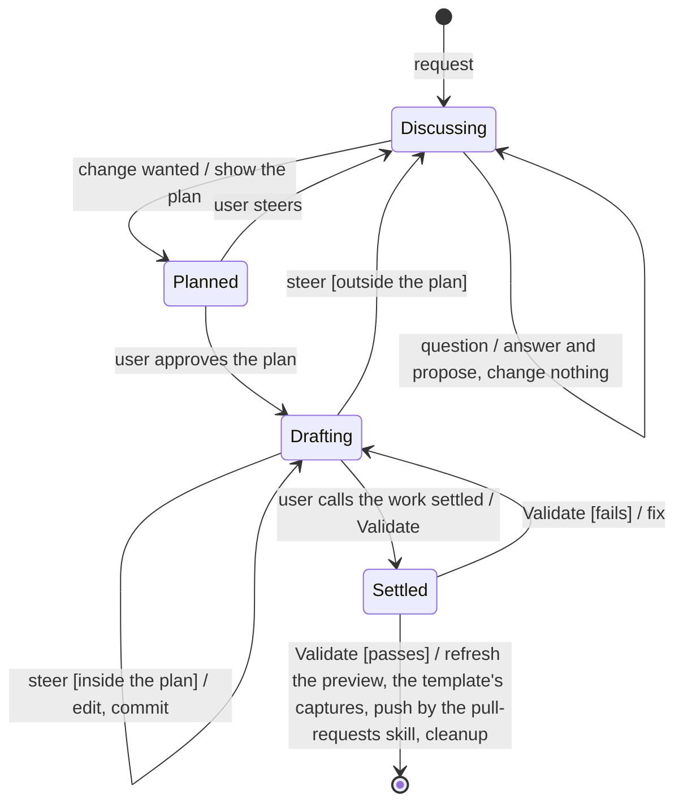
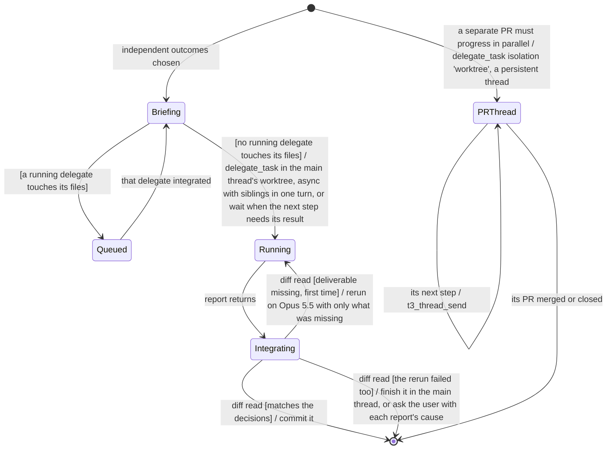
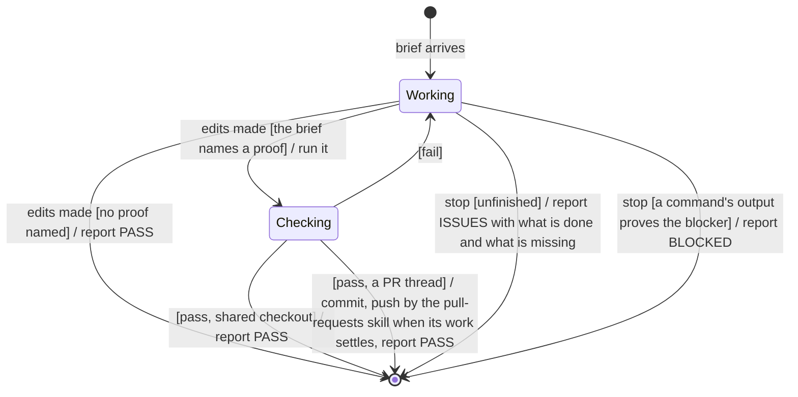

# Orchestrator

## Task

- **Checks wait for settle.** While drafting, no fixer, checks, tests, pushes or preview restarts unless the user asks or a capture needs one; Validate runs them once.

- **Plan.** A UI plan is a rough HTML prototype, an architecture plan a diagram, made in minutes without the code reading a replica needs: 2–3 genuinely different directions you would build, side by side on the same data, without filters or captions; a better idea than the user's is one of them.
- **Precedent.** Before an edit, read how the neighbouring feature or shared package does it.
- **Outside code.** Using an external package or needing a reference, clone and read its repository from [Repositories](references/repos.md); never assume its behaviour.
- **Cleanup** removes what you created and settles delegates and PR threads with their worktrees; the shared preview stays.
- **One owner.** One main thread per worktree: check `t3_thread_list` first and send evidence to a live owner.
- **Main.** Do small edits, prototypes and needed reads yourself, since a delegate costs a brief and a report on a thread that re-reads its context every call.
- **Context.** One thread per task; after compaction, read the task list, the thread and running delegates' latest results before asking.
- **Side chat.** A read-only fork; it reports back only when the user asks.

## Route

The user picks the main thread's model and effort; this table routes delegates.

| Work                                                                                                           | Model         | `target`                            |
| -------------------------------------------------------------------------------------------------------------- | ------------- | ----------------------------------- |
| Default: edits, browser walks, research, captures; long or overnight runs, since Codex's cache does not expire | GPT-6.1 Sol   | `codex` / `gpt-6.1-sol`             |
| UI code, quick reads; removals, since Codex rejects `rm -f` and `rm -rf`                                       | Sonnet 5.5    | `claudeAgent` / `claude-sonnet-5-5` |
| A build whose UI or architecture is still open                                                                 | Opus 5.5      | `claudeAgent` / `claude-opus-5-5`   |
| Only when the user picks it                                                                                    | Fable 5.2     | `claudeAgent` / `claude-fable-5-2`  |
| Trial: bounded reads, searches, runs and checks                                                                | GPT-6.1 Terra | `codex` / `gpt-6.1-terra`           |
| Never                                                                                                          | Luna, Haiku   |                                     |

- **Trial.** Compare Terra's reports with Sol's before it becomes a default.
- **Effort.** Medium (`effort` on Claude, `reasoningEffort` on Codex); high when the task needs it; never low, xhigh or above.

## Delegation

- **One checkout.** The main thread already owns its worktree and branch, so delegates get none; sharing one index, they never commit.
- **One outcome per delegate.** Coupled edits share one thread, since split halves come back for the main thread to reconcile. A procedure is a skill, not a child agent.
- **No handoff files.** Context travels in the brief and the report, never a file one side writes and the other reads.

## Brief

About 1,500 characters: the delegate already has the instructions, the skills and the checkout with its uncommitted edits, but not the thread; a PR thread's worktree starts at the parent's commit, without them. Give only the objective, the settled decisions, the files it owns, what to leave alone, the narrowest command that proves it, when one does, and the report you want.

## Delegate run

A delegate runs its brief as the approved plan, edits only the brief's files and starts no delegates.

- **Report.** Short: its status word, then evidence (command, exit code, `path:line`, and a SHA only for a commit it made), not narration.
