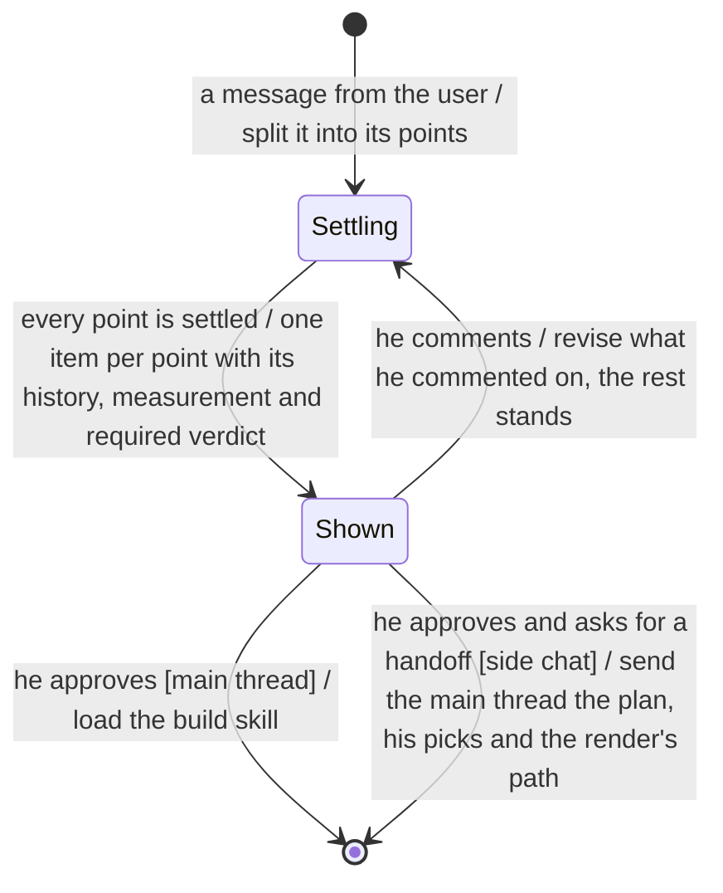

# Plan

- **Points.** One item per point, however mixed the message: a bug as its failing probe and its fix, a question answered beside the screen or code it is about, a choice as variants. A small change is a plan of one item. A line holding only `---` separates requests; an approval, or a comment on a quote, covers only its own.
- **Settle** from code, docs, tests or a probe everything, taste included, except what is the user's: UI and architecture choices, product, access and money.
- **UI.** Every UI point goes in the first reply as a copy of [prototype.html](references/prototype.html), built by its header: one decision per point, Today beside each variant, `FIRST` the thread's next free number. A pattern several pages share is shown once, on a realistic page with all its states.
- **Architecture.** Each variant as a traced value, a contract diff, a role-by-operation grid or sample rows before and after; a process as a diagram.
- **Variants.** Two or three, only for UI and architecture, a better idea than his among them.
- **Sleep.** When he says he is going to sleep or away, the advisors answer in his place: they approve the plan and each later choice only he would make, one commit per answer, and the last reply lists them. A PR still stays a draft.
- **Handoff.** A side chat sends its plan only once he approves it there, with a `/compact <what to keep>` line for him when the main thread's context is heavy.

## Advisors and council

- **Advisors.** At any stage, get their verdict for every item whose cost changes what the user sees or waits for, and whenever the Sleep rule applies.
- **Council.** Use it when no clear direction remains or you are stuck.
- **Brief.** The same to each: the question, the options, and the user's words and `AGENTS.md` choices that bear on it.

|         | Advisors                                                                                                 | Council                                                                                               |
| ------- | -------------------------------------------------------------------------------------------------------- | ----------------------------------------------------------------------------------------------------- |
| For     | A choice between known options                                                                           | No clear direction: ideas, approaches                                                                 |
| Who     | Fable 5.2 at high; GPT-6.2 Astra at high beside it for architecture, in sleep, and when you run on Fable | GPT-6.1 Terra, GPT-6 Luna, Sonnet 5.5 and Haiku 5.5 at medium, read-only, each from a different angle |
| Returns | The pros and cons of every option, and a verdict                                                         | An approach each: merge their best parts, or show them as the variants                                |
