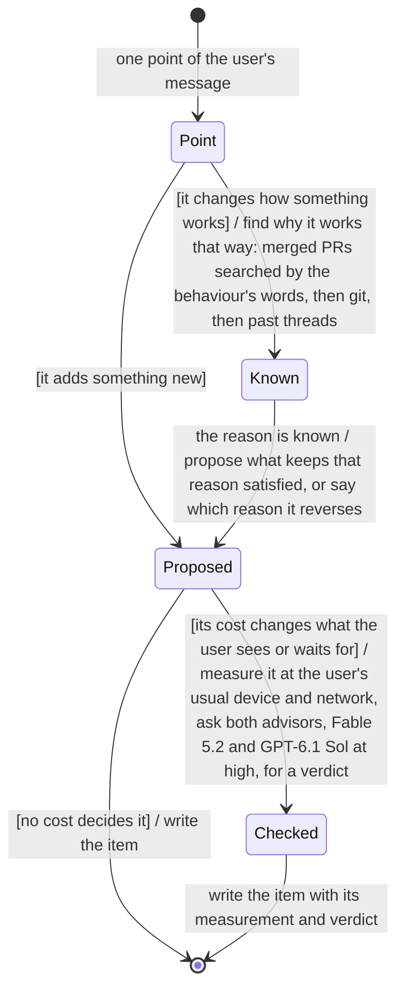

# Plan

- **Points.** A message is split into its points, however mixed, and each becomes one item of the reply: a bug as its fix before and after, a question answered beside the screen or code it is about, a choice as variants.
- **UI.** Every UI point is shown in the first reply, in a copy of [prototype.html](references/prototype.html) built by its header: one decision per point, Today beside each variant, and a point with one fix as Today beside `a`. `FIRST` is the thread's next free number. The render is the whole answer for those points: no list, table or question repeats it.
- **Architecture.** Each variant as a traced value, a contract diff, a role-by-operation grid or sample rows before and after.
- **Variants** exist only for UI and architecture: two or three different ways to solve the same thing, differing in structure or interaction, never slight variations of one, with a better idea than the user's among them. Everything else you decide and show.

