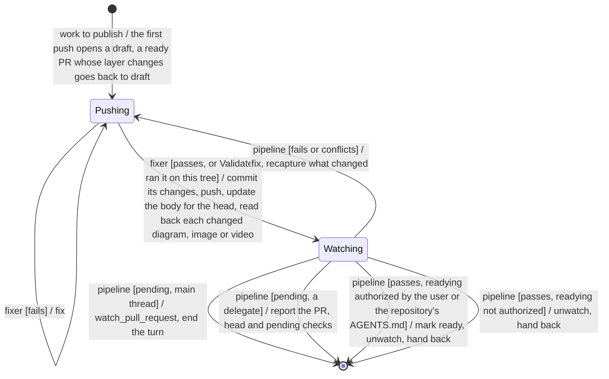

# Pull requests

## Branches

- **One PR per change.** More work on the same change goes into its unmerged PR, edited in place. Split only what is independent, or a different layer of the same change; each PR runs on its target, with generated files beside their source.
- **Stacks** ease review, not stepwise merging: PRs that depend on each other form one stack, one branch per layer, each readable alone. Restack with the host's stack commands, because a hand retarget loses the stack's tracking.
- **Reshape.** Remove a rejected approach from every unmerged layer rather than undoing it in a layer above.
- **Integration.** Fold corrections into their owning layers, then restack onto the latest default branch before Validate.
- **Before.** When a before/after is claimed, capture Before on base before the first edit.

## Lifecycle



- **Push** once per affected PR per round, since each push cancels the previous pipeline.
- **Describe** by filling `.github/pull_request_template.md` on GitHub, `.gitlab/merge_request_templates/Default.md` on GitLab. Trim a recording's lead-in (seconds from its start to `play`'s, verification skill) and still stretches:

  ```bash
  ffmpeg -ss <lead> -i <recording> -vf "mpdecimate=hi=1:lo=1:frac=0,setpts='if(eq(N,0),0,PREV_OUTPTS+min(PTS-PREV_INPTS,1/TB))',fps=60,scale=out_range=tv,format=yuv420p" -c:v libx264 -pix_fmt yuv420p -color_range tv -movflags +faststart -an <trimmed>.mp4
  ```

## Commands

Captures upload with `--attach`, since host API writes are forbidden.

```bash
gh pr edit <n> --title '<title>' --body-file - --attach './shot.png#<alt>' <<'EOF'  #  becomes the upload
<body>
EOF
gh pr edit <n> --attach './proof.mp4'    # appends the video URL: move it under its claim, alone in its paragraph
gh api repos/<owner>/<repo>/pulls/<n> -H 'Accept: application/vnd.github.html+json' --jq .body_html
glab mr update <n> --description-file - --attach ./shot.png <<'EOF'   # appends the reference: move it under its claim
glab api "projects/:id/merge_requests/<n>?render_html=true" | jq -r .description_html
glab api "projects/:id/pipelines/<pipeline>/jobs?scope[]=failed" | jq -r '.[] | "\(.id) \(.name)"'; glab ci trace <job id>
```

**GitHub stacks** act on the checked-out branch's stack; GitHub rebases the next layer when the one below merges.

```bash
gh stack init <bottom> [<next> …]    # start, or adopt existing branches bottom first
gh stack add <branch>                # a new layer on top, checked out before its first commit
gh stack rebase [--upstack]          # before a push, or above an amended layer; --continue or --abort on a conflict
gh stack submit --auto               # first push: opens each PR as a draft on its parent
gh stack push                        # later rounds
gh stack sync --prune                # after a merge below
gh stack unstack --local             # drop tracking of a stack that was never submitted
```

**GitLab stacks** act on the stack selected in this worktree: one commit per diff on its own branch, whose first message line is the MR title (`Draft: ` opens a draft). Every MR of a stack comes from `sync`, which never edits an existing MR.

```bash
git commit -m 'Draft: <title>'
script -qec "GLAB_EDITOR='sh -c \"git rev-list --reverse origin/<default>..HEAD > \\\$1\" -' glab stack infer --name <stack> origin/<default>..HEAD" /dev/null
git add -A && glab stack save -m 'Draft: <title>'    # a new layer; `amend` folds into the checked-out one
glab stack sync --skip-push --update-base            # before Validate, and after a merge below: rebase onto the base, drop merged diffs
glab stack sync                                      # push the validated stack, open missing MRs
```

`infer` needs a TTY and an editor, and its range starts at `origin/<default>` since the local default branch can lag; `glab stack create` cannot run in a worktree. `glab stack reorder` takes the same `script` and editor shape, one branch per line, then `glab stack sync`.
