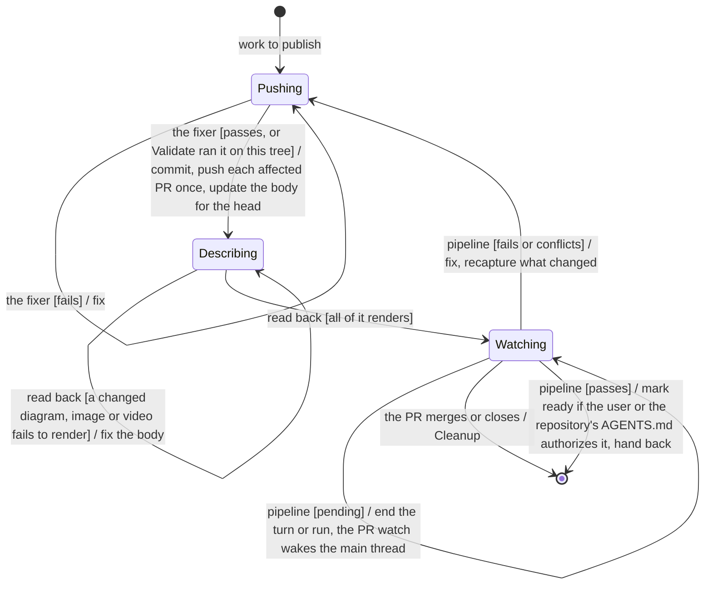

# Pull requests

## Branches

- **One PR per change.** More work on the same change goes into its unmerged PR. Split only what is independent, or a different layer of the same change, each running on its target with generated files beside their source.
- **Stacks.** Dependent PRs form one stack, one branch per layer, each readable alone, restacked only with the host's [stack commands](references/stacks.md); a rejected approach leaves every unmerged layer, and corrections fold into their owning layer before restacking onto the latest default branch.
- **Before.** When a before/after is claimed, capture Before on base before the first edit.

## Lifecycle



- **Drafts.** The first push opens a draft; a ready PR whose layer changes goes back to draft.
- **Describe** by filling `.github/pull_request_template.md` on GitHub, `.gitlab/merge_request_templates/Default.md` on GitLab. Trim a recording to `play`'s start (verification skill) and its still stretches:

  ```bash
  ffmpeg -ss <lead> -i <recording> -vf "mpdecimate=hi=1:lo=1:frac=0,setpts='if(eq(N,0),0,PREV_OUTPTS+min(PTS-PREV_INPTS,1/TB))',fps=60,scale=out_range=tv,format=yuv420p" -c:v libx264 -pix_fmt yuv420p -color_range tv -movflags +faststart -an <trimmed>.mp4
  ```

## Commands

Captures upload with `--attach`, since host API writes are forbidden.

```bash
gh pr edit <n> --title '<title>' --body-file - --attach './shot.png#<alt>' <<'EOF'  #  becomes the upload
<body>
EOF
gh pr edit <n> --attach './proof.mp4'    # appends the video URL: move it under its claim, alone in its paragraph
gh api repos/<owner>/<repo>/pulls/<n> -H 'Accept: application/vnd.github.html+json' --jq .body_html
glab mr update <n> --description-file - --attach ./shot.png <<'EOF'   # appends the reference: move it under its claim
glab api "projects/:id/merge_requests/<n>?render_html=true" | jq -r .description_html
glab api "projects/:id/pipelines/<pipeline>/jobs?scope[]=failed" | jq -r '.[] | "\(.id) \(.name)"'; glab ci trace <job id>
```
