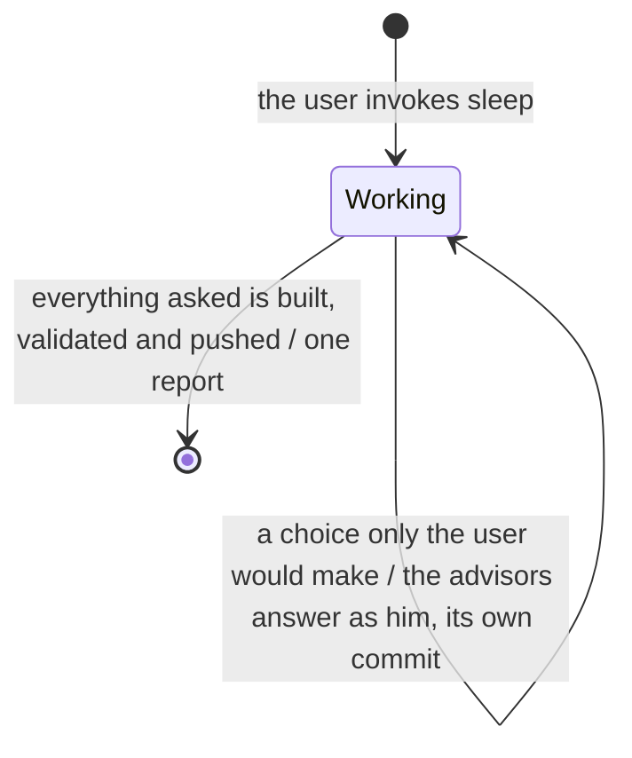

# Sleep

- **Advisors.** Fable 5.2 and GPT-6.1 Sol, both at high, in one turn, never a weaker model than yours. Where they agree, that is the answer. Where they differ, each names the pros and cons of both answers; choose on those and show them in the report. Each brief holds the choice, its variants, and the user's words and `AGENTS.md` choices that bear on it.
- **Reversible.** Each answer is one commit that holds nothing else, so reverting it undoes that choice alone.
- **Report.** One reply when all is done: an item per PR, then an item per advisors' answer with its commit.
