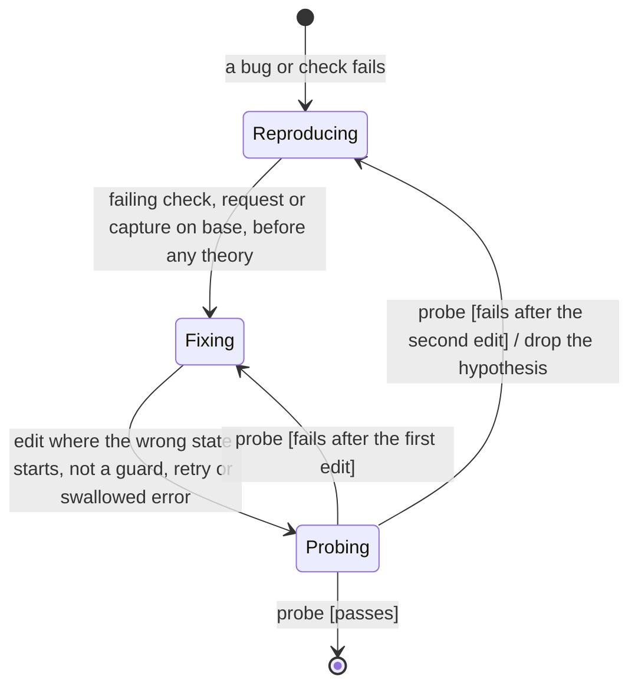
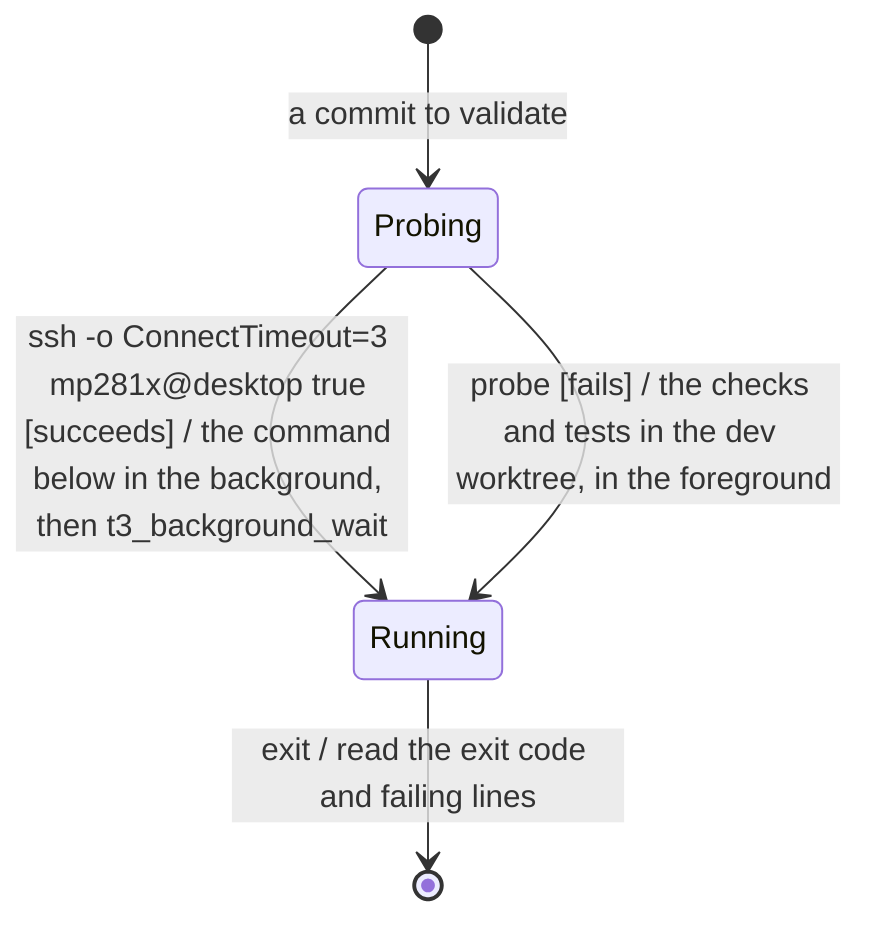
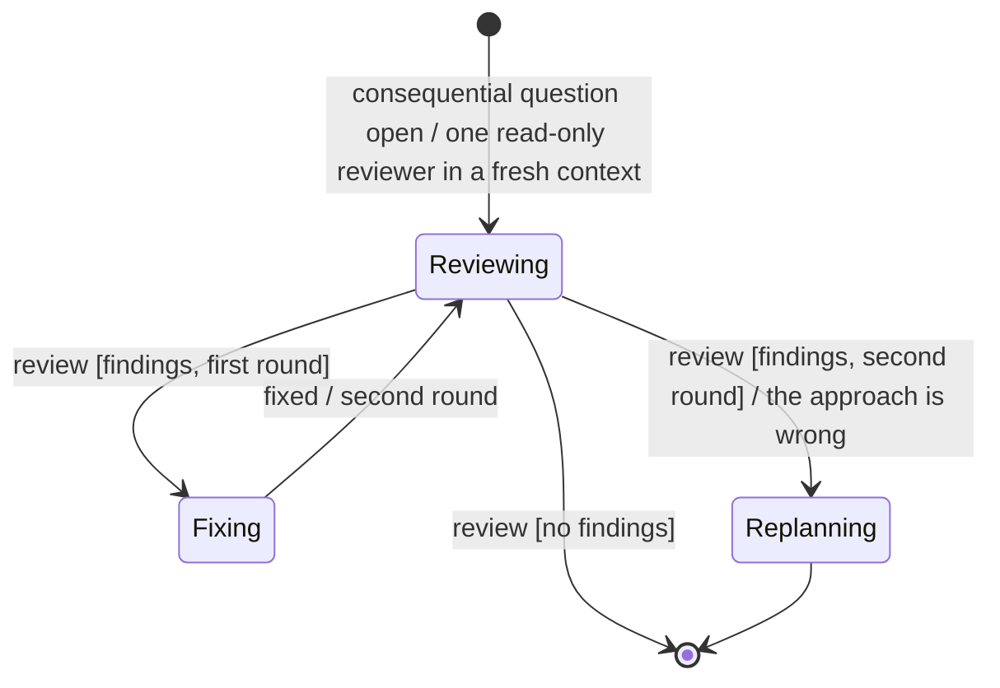

# Verification

Lint owns what a parser can check; this covers running behaviour. The repository's `AGENTS.md` names its fixer, checks and tests.

## Diagnose



## Validate

The main thread validates itself, with no delegate and no fixer, which already ran on dev.



```bash
ssh mp281x@desktop 'cd ~/<repo> && w=/tmp/validate/<repo>-<dev worktree name> && git fetch -q ssh://mp281x@dev<dev worktree path> <sha> && { git -C $w checkout -q --detach <sha> 2>/dev/null || git worktree add -q --detach $w <sha>; } && cd $w && vp install && <checks> && <tests>'
```

Each thread reuses its own validation worktree, so dependencies and the `vp` cache stay warm and threads need no locks; nothing is pushed and no branch is created. [Maintenance](../environment/references/maintenance.md#clean) removes it.

## Prove

- **Surface.** UI, and backend changes a screen shows, in the T3 browser; native changes in the Device panel. This standing request covers the preview tools.
- **Capture** representative data once a condition holds, on the head, with its short commit in the caption; a rebase retakes them all.
- **Fixed means flipped.** The probe that failed on base passes on the head.
- **States.** Cold open, deep-link reload and a failed first request; `iphone-12-pro` and 1440×900, plus the widest target reached; dark and light when colour changed; web and iOS side by side when both exist.
- **Read each capture** for duplicates, clipping, overflow and untruthful loading, empty or error states, and audit web states with `preview_evaluate` and [references/page-audit.js](references/page-audit.js).
- **Unproved** claims say `unverified: <what was not run>`.

## Review

Never for decided work, which a review only re-argues.



- **Input.** The decisions, the user's acceptance criteria, the head and the captures; the reviewer opens its own preview, since source is not evidence.
- **Scope.** Architecture, UI/UX and function, not lint's domain.
- **Finding.** The input, the result, `path:line` and a severity: P1 broken contract, data loss, secret exposure or false claim; P2 architecture or ownership violation; P3 reads worse than the recorded design.

## Tests

Keep a reproducing probe only under the repository's test choices, at the narrowest public seam.
