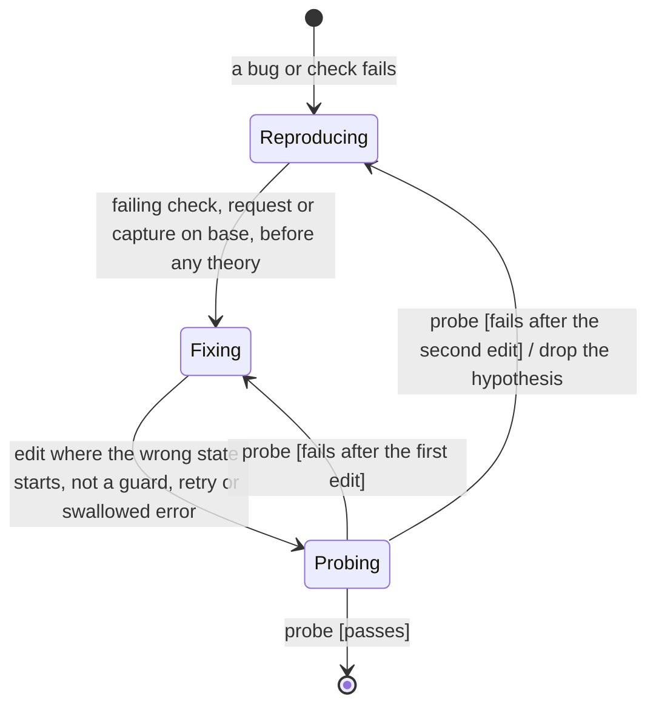
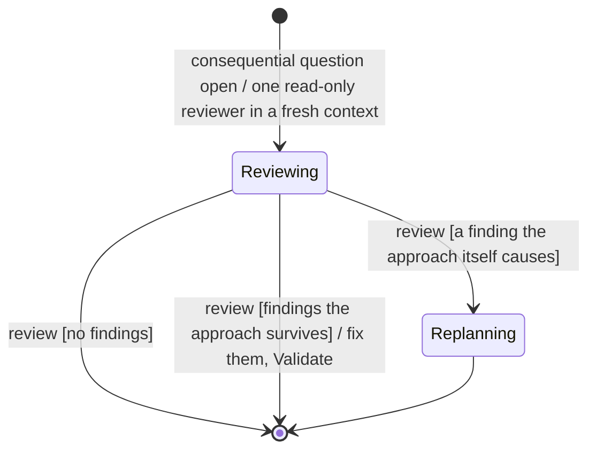

# Verification

Lint owns what a parser can check; this covers running behaviour. The repository's `AGENTS.md` names its fixer, checks and tests.

## Diagnose

## Validate

Run the repository's checks locally on what you changed: the tests that cover it, and the fixer and checks scoped to the touched packages where the repository's commands allow. Then push; the CI pipeline runs the rest (pull-requests skill, **Lifecycle**).

## Prove

- **Surface.** UI, and backend changes a screen shows, in the T3 browser; native changes in the Device panel. This standing request covers the preview tools.
- **Capture** representative data once a condition holds, on the head, with its short commit in the caption.
- **Fixed means flipped.** The probe that failed on base passes on the head.
- **States.** One trimmed recording per app reached, plus only the states the change touches: cold open, deep-link reload, a failed first request, a viewport (`iphone-12-pro`, 1440×900, the widest target), dark or light.
- **Read each capture** for duplicates, clipping, overflow and untruthful loading, empty or error states, and audit web states with `preview_evaluate` and [references/page-audit.js](references/page-audit.js).
- **Unproved** claims say `unverified: <what was not run>`.

## Review

Never for decided work, which a review only re-argues.

- **Input.** The decisions, the user's acceptance criteria, the head and the captures; the reviewer opens its own preview, since source is not evidence.
- **Scope.** Architecture, UI/UX and function, not lint's domain.
- **Finding.** The input, the result, `path:line` and a severity: P1 broken contract, data loss, secret exposure or false claim; P2 architecture or ownership violation; P3 reads worse than the recorded design.

## Tests

Keep a reproducing probe only under the repository's test choices, at the narrowest public seam.
