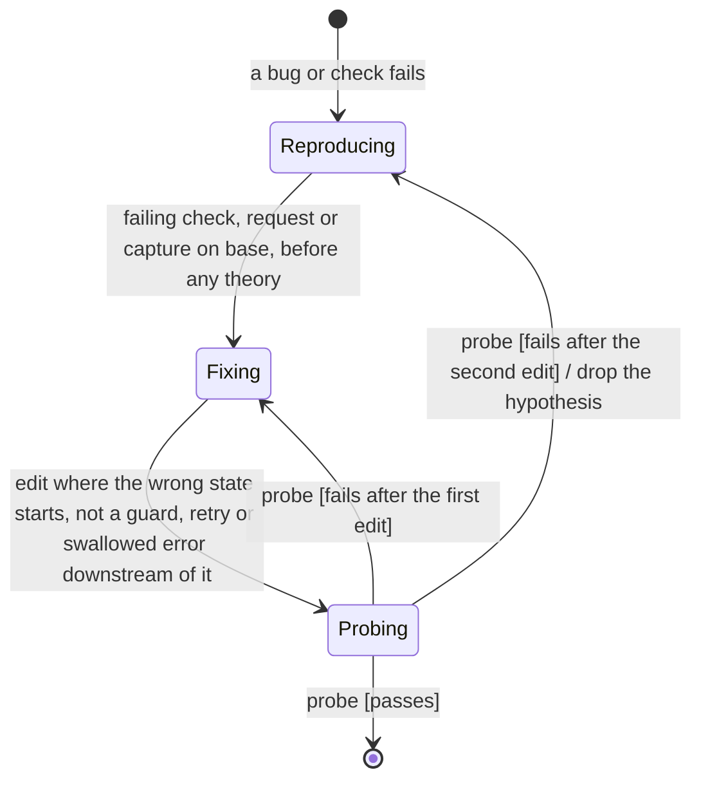
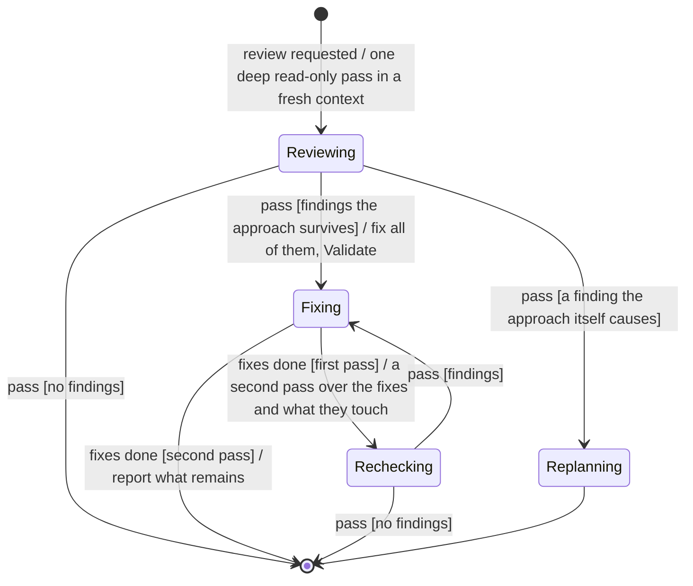

# Verification

Lint owns what a parser can check; this covers running behaviour. The repository's `AGENTS.md` names its fixer, checks and tests.

## Diagnose

## Validate

Run the repository's checks locally on what you changed: the tests that cover it, and the fixer and checks scoped to the touched packages where the repository's commands allow. Then push; the CI pipeline runs the rest (pull-requests skill, **Lifecycle**).

## Prove

- **Surface.** UI, and backend changes a screen shows, in the T3 browser; native changes in the Device panel. This standing request covers the preview tools.
- **Capture** representative data once a condition holds, on the head, with its short commit in the caption.
- **Record** a flow in one turn: `preview_recording_start`, then `preview_evaluate` with [journey.js](references/journey.js)'s text plus `play(task, [...steps])`, then `preview_recording_stop`. It frames the still page under the task and its step bar and names each step in the frame; it returns `{from, outcomes}`, and the trim starts at `from` minus the recording's `startedAt`. A step is `'Name'`, a click on the visible element labelled Name or a CSS selector; `{type, into}`; `{press}`; `{see}`, waiting for text; or `{say}`, a caption alone; any takes a `label`. The first failed step ends the run with its reason in `outcomes`.
- **Fixed means flipped.** The probe that failed on base passes on the head.
- **States.** Only the states the change touches: cold open, deep-link reload, a failed first request, a viewport among the repository's targets, else `iphone-12-pro` and 1440×900, dark or light.
- **Read each capture** for duplicates, clipping, overflow and untruthful loading, empty or error states, and audit web states with `preview_evaluate` and [references/page-audit.js](references/page-audit.js).
- **Unproved** claims say `unverified: <what was not run>`.

## Review

- **Depth.** A pass reports every finding it can reach at once, never a sample; a request to loop until clean still gets two.
- **Input.** The decisions, the user's acceptance criteria, the head and any captures; a UI reviewer opens its own preview, since source does not prove what renders.
- **Scope.** Architecture, UI/UX and function, not lint's domain.
- **Finding.** The input, the result, `path:line` and a severity: P1 broken contract, data loss, secret exposure or false claim; P2 architecture or ownership violation; P3 reads worse than the recorded design.

## Tests

Keep a reproducing probe only under the repository's test choices, at the narrowest public seam.
