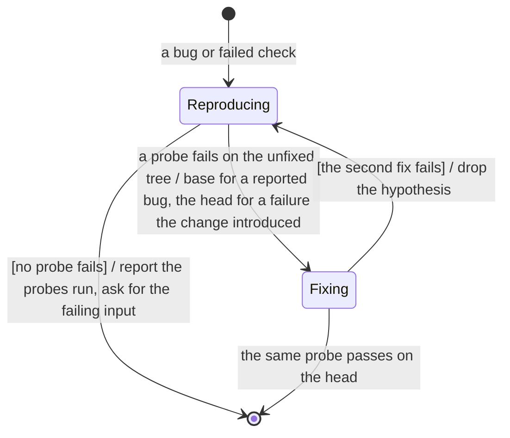
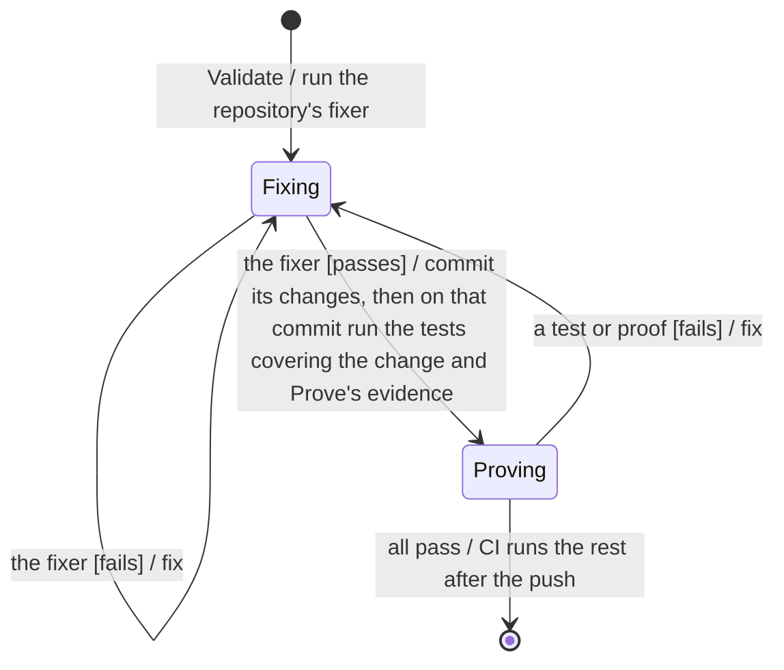
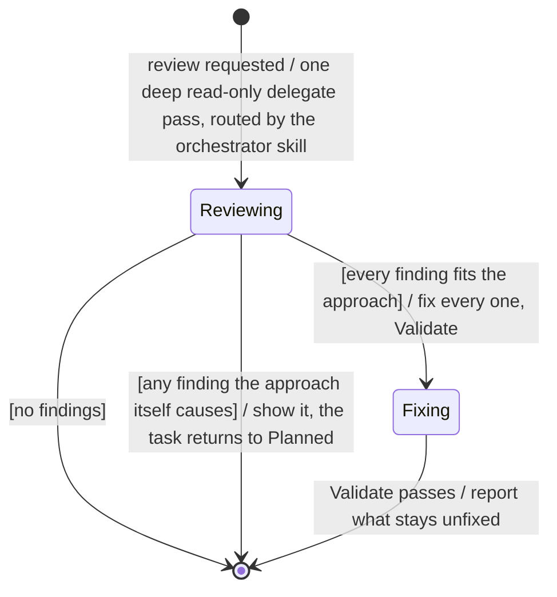

# Verification

Lint owns what a parser can check; this covers running behaviour. The repository's `AGENTS.md` names its fixer, checks and tests.

## Diagnose

- **Probe.** A check, request or capture, run before any theory.
- **Fix** where the wrong state starts, not with a guard, retry or swallowed error downstream of it.

## Validate

- **Evidence** stays valid while its inputs are unchanged.

## Prove

- **Surface.** UI, and backend changes a screen shows, in the T3 browser; native changes in the Device panel. This standing request covers the preview tools.
- **Capture** representative data on the head, after waiting for the state's own text or element, never a timer, with its short commit in the caption.
- **Record** a flow in one turn: `preview_recording_start`, then `preview_evaluate` with [journey.js](references/journey.js)'s text plus `play(task, [...steps])`, then `preview_recording_stop`. A step is `'Name'` (a click on the visible element labelled Name, or a CSS selector), `{type, into}`, `{press}`, `{see}` (waits for text) or `{say}` (a caption alone); any takes a `label`. The first failed step ends the run; `play` returns `{from, outcomes}`, and the trim starts at `from` minus the recording's `startedAt`.
- **States.** Of cold open, deep-link reload and a failed first request, those the change touches, at one of the repository's target viewports (none listed: `iphone-12-pro` and 1440×900), in one colour scheme.
- **Read each capture** for duplicates, clipping, overflow, untruthful loading, empty or error states, and any screen, label, state or click path that differs from the approved render; audit web states with `preview_evaluate` and [page-audit.js](references/page-audit.js).
- **Unproved** claims say `unverified: <what was not run>`.

## Review

- **Depth.** The pass reports every finding it can reach at once, never a sample.
- **Input.** The decisions, the approved render, the user's acceptance criteria, the head and any captures; a UI reviewer opens its own preview, since source does not prove what renders.
- **Finding.** Architecture, UI/UX and function, not lint's domain: the input, the result, `path:line` and a severity. P1 broken contract, data loss, secret exposure or false claim; P2 architecture or ownership violation; P3 a difference from the approved render, or a screen that reads worse than the recorded design.
- **Tests.** Keep a reproducing probe only under the repository's test choices, at the narrowest public seam.
