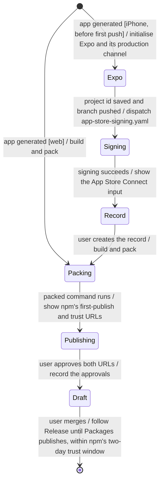

# Releasing

- **History.** `main` is linear: every PR is squash-merged.
- **Verification.** A PR is verified by its `pull_request` run of Verify, whose three jobs, Build, Check and Test, test GitHub's merge of the PR with its base at the last push. A PR is ready once that run passed on the merge with the latest `main`; when `main` moves, rebase and push for a new run. A PR with a merge conflict gets no run until it is rebased, and pushing a branch with no PR verifies nothing.
- **Actions.** Actions use their major tag, such as `actions/cache@v6`, never a commit; `setup-vp`'s `v1` stopped at 1.15, so it names its latest release.
- **Release.** Release skips Verify only when a passed run of all three jobs tested exactly the tree that was merged; otherwise it runs all three, the built-server probe included, on the release tree before anything ships.

## A new app



| State   | Input or command                                                                                                                                                                                                                                                                    |
| ------- | ----------------------------------------------------------------------------------------------------------------------------------------------------------------------------------------------------------------------------------------------------------------------------------- |
| Expo    | In `apps/<name>`, run `vpx eas-cli@latest init --non-interactive --account mp281x.xyz`. It prints `extra.eas.projectId` when writing dynamic config fails: save that as `projectId` in `app.config.ts`. Run `vpx eas-cli@latest channel:create production --non-interactive` there. |
| Signing | `gh workflow run app-store-signing.yaml --ref <branch> -f app=<name>`; read `gh run view <run-id> --log`. For an already signed app, it enables declared Associated Domains if missing and replaces only profiles missing a declared entitlement.                                   |
| Record  | User input at [App Store Connect](https://appstoreconnect.apple.com/apps), **+**, **New App**: iOS, a free name, English (U.S.), bundle `xyz.mp281x.<name>`, SKU `<name>`, full access. Only the website creates the record; signing must first make the bundle selectable.         |

| Signing failure                                | Next action                                                                                                                                          |
| ---------------------------------------------- | ---------------------------------------------------------------------------------------------------------------------------------------------------- |
| Already signed for the App Store               | All App Store profiles contain their target's declared entitlements.                                                                                 |
| Partly signed                                  | The user removes the named App Store profiles in [Apple's profile list](https://developer.apple.com/account/resources/profiles/list); rerun signing. |
| Generate a new Apple Distribution Certificate? | A new team certificate is an item the user picks in `vpx eas-cli@latest credentials`, in the app directory.                                          |
| Any other unexpected prompt                    | Add it to the workflow only if its default is the intended answer.                                                                                   |
| Apple 403                                      | Replace `ASC_KEY_ID`, `ASC_ISSUER_ID` and `ASC_KEY_P8` with an Admin-access key.                                                                     |

Packing, with the command's working directory set to `apps/<name>`, packs as Release does. The subshell stops at the first failure, so a failed build leaves the fresh `$PACK` empty instead of packing an older `dist`, and it restores the manifest either way:

```bash
PACK=$(mktemp -d)
(
  set -e
  cp package.json "$PACK/manifest.json"
  trap 'cp "$PACK/manifest.json" package.json' EXIT
  vp run build
  npm pkg delete dependencies devDependencies scripts main
  vp pm pack --pack-destination "$PACK"
)
vpx --package "$PACK"/deslop-<name>-0.1.0.tgz <name> --help
```

Publish and trust commands print npmjs.com approval URLs lasting about five minutes: run each in the background and show its URL. The first approval can skip further two-factor checks for five minutes.

```bash
npm whoami
# If signed out:
script -qefc 'npm login --auth-type=web' /dev/null
script -qefc "npm publish $PACK/deslop-<name>-0.1.0.tgz --auth-type=web" /dev/null
script -qefc 'npm trust github @deslop/<name> --file deploy.yaml --repo MP281X/deslop --allow-publish --yes' /dev/null
```

A trust record expires unless a trusted publish succeeds within two days of `npm trust`, and Release publishes packages only after every iPhone app ships: merge early enough for that Release to reach Packages. An expired record can't be used or edited; `npm trust list @deslop/<name>` shows its id, `npm trust revoke @deslop/<name> --id=<id>` removes it, then run the trust command again.

A publishable tool uses `tools/coding-standards`' publish fields and `pack.deps`, starts at `0.1.0` and joins the Packages job; pack it with `vp -C tools/<name> pm pack` for its first publish. Generated libraries are bundled into their consumers, not published.

## Follow a release

Read a failed job with `gh run view <run-id> --job <job-id> --log`. Each state is separate; report each, with the run URL:

| State  | Reached when                                                                                                                                                                                                                                                                                                                                                                                                                                                                                                                                                   |
| ------ | -------------------------------------------------------------------------------------------------------------------------------------------------------------------------------------------------------------------------------------------------------------------------------------------------------------------------------------------------------------------------------------------------------------------------------------------------------------------------------------------------------------------------------------------------------------- |
| Apple  | `altool --upload-package` succeeded and the run holds the `<app>-app-store-<fingerprint>` receipt; a retry then skips the build. A run that ended after Apple accepted without saving the receipt (the runner died, or a step or the receipt's upload failed) cannot be retried, as Apple refuses its build number a second time: the next release builds and uploads that fingerprint once more, as it does once a receipt has expired after 80 days. Uploaded is not processing: check processing or available at the TestFlight URL from the run's summary. |
| Update | The EAS Update reached the branch the `production` channel serves. A run older than the served update publishes none, and its summary says so. A phone gets it only on a build with the same fingerprint.                                                                                                                                                                                                                                                                                                                                                      |
| npm    | `npm view @deslop/<name>@0.1.<run-number> fingerprint` answers. A retry finds a version an earlier attempt published; a version newer than the run's stays.                                                                                                                                                                                                                                                                                                                                                                                                    |
| Worker | The worker's update timer installed it: `/api/runtime` returns 200 and reports the new version.                                                                                                                                                                                                                                                                                                                                                                                                                                                                |

Public TestFlight and App Store release are separate outward actions.

## Simulator builds

Every command here and every workflow that loads an app's config reads `DESLOP_DOMAIN`, the repository variable of that name (`.env.example`); export it first. A branch push touching a mobile app or shared packages builds a missing `<app>-simulator-<fingerprint>-<recipe>` artifact, and signs the production build of a production fingerprint that has no `<app>-signed-<fingerprint>-<recipe>` marker yet, without uploading it. The recipe names this checkout's `simulator.yaml` and setup action, so a build is taken only from the same ones. The app holds the JavaScript of the commit that built it, so embed the branch's bundle before installing it:

```bash
# Run in apps/stash:
fingerprint=$(APP_VARIANT=development vpx eas-cli@latest fingerprint:generate --platform ios --build-profile simulator --json --non-interactive | jq -r .hash)
# Run the remaining commands from the worktree root:
recipe=$(git rev-parse HEAD:.github/workflows/simulator.yaml HEAD:.github/actions/setup | sha256sum | cut -c1-12)
run=$(gh api "repos/MP281X/deslop/actions/artifacts?name=stash-simulator-$fingerprint-$recipe" --jq '[.artifacts[] | select(.expired | not) | .workflow_run.id] | first // empty')
gh run download "$run" --name stash-simulator-$fingerprint-$recipe --dir /tmp/stash-sim
tar -xzf /tmp/stash-sim/simulator.tar.gz -C /tmp/stash-sim
APP_VARIANT=development vp -C apps/stash exec expo export:embed --platform ios --dev false --bundle-output /tmp/stash-sim/stashdev.app/main.jsbundle --assets-dest /tmp/stash-sim/stashdev.app
vp -C apps/stash exec expo prebuild --platform ios --no-install --clean
rm -rf apps/stash/ios   # config check before a native change
```

opm and trips build the same way, with bundle `xyz.mp281x.<app>.dev`.

## Native tools

To update Stash's FFmpeg, ffprobe or yt-dlp or Deploy's Caddy, take the upstream Linux x64 release, replace its license file (FFmpeg's names its version and build), then `zstd -19 --long=27 <tool> -o apps/<app>/bin/<tool>.zst`, staying below GitHub's 100 MB file limit.
