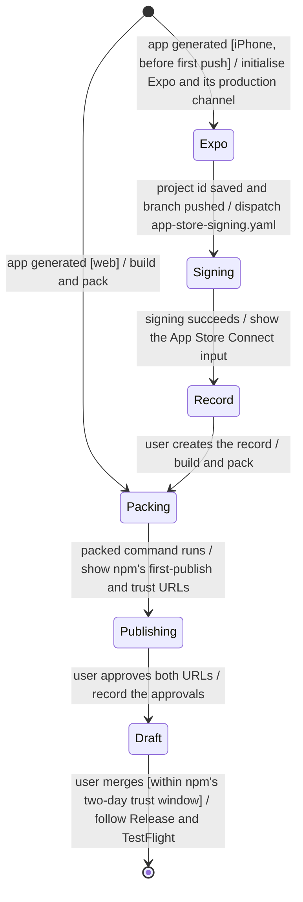

# Releasing

- **History.** `main` is linear: every PR is squash-merged.

## A new app



| State   | Input or command                                                                                                                                                                                                                                                                    |
| ------- | ----------------------------------------------------------------------------------------------------------------------------------------------------------------------------------------------------------------------------------------------------------------------------------- |
| Expo    | In `apps/<name>`, run `vpx eas-cli@latest init --non-interactive --account mp281x.xyz`. It prints `extra.eas.projectId` when writing dynamic config fails: save that as `projectId` in `app.config.ts`. Run `vpx eas-cli@latest channel:create production --non-interactive` there. |
| Signing | `gh workflow run app-store-signing.yaml --ref <branch> -f app=<name>`; read `gh run view <run-id> --log`. For an already signed app, it replaces only profiles missing a declared entitlement.                                                                                      |
| Record  | User input at [App Store Connect](https://appstoreconnect.apple.com/apps), **+**, **New App**: iOS, a free name, English (U.S.), bundle `xyz.mp281x.<name>`, SKU `<name>`, full access. Only the website creates the record; signing must first make the bundle selectable.         |

| Signing failure                                | Next action                                                                                                                                          |
| ---------------------------------------------- | ---------------------------------------------------------------------------------------------------------------------------------------------------- |
| Already signed for the App Store               | All App Store profiles contain their target's declared entitlements.                                                                                 |
| Partly signed                                  | The user removes the named App Store profiles in [Apple's profile list](https://developer.apple.com/account/resources/profiles/list); rerun signing. |
| Generate a new Apple Distribution Certificate? | A new team certificate is an item the user picks in `vpx eas-cli@latest credentials`, in the app directory.                                          |
| Any other unexpected prompt                    | Add it to the workflow only if its default is the intended answer.                                                                                   |
| Apple 403                                      | Replace `ASC_KEY_ID`, `ASC_ISSUER_ID` and `ASC_KEY_P8` with an Admin-access key.                                                                     |

Packing, with the command's working directory set to `apps/<name>`; the subshell restores the manifest even on failure:

```bash
PACK=$(mktemp -d)
vp run build
(
  set -e
  cp package.json "$PACK/manifest.json"
  trap 'cp "$PACK/manifest.json" package.json' EXIT
  npm pkg delete dependencies devDependencies scripts main
  npm pack --pack-destination "$PACK"
)
vpx --package "$PACK"/deslop-<name>-0.1.0.tgz <name> --help
```

Publish and trust commands print npmjs.com approval URLs lasting about five minutes: run each in the background and show its URL. The first approval can skip further two-factor checks for five minutes.

```bash
npm whoami
# If signed out:
script -qefc 'npm login --auth-type=web' /dev/null
script -qefc "npm publish $PACK/deslop-<name>-0.1.0.tgz --auth-type=web" /dev/null
script -qefc 'npm trust github @deslop/<name> --file deploy.yaml --repo MP281X/deslop --allow-publish --yes' /dev/null
```

A publishable tool uses `tools/coding-standards`' publish fields and `pack.deps`, starts at `0.1.0` and joins the Packages job; pack it with `vp -C tools/<name> pm pack` for its first publish. Generated libraries are bundled into their consumers, not published.

## Follow a release

The App Store job uploads the `.ipa` from GitHub's Mac with `altool --upload-package` and fails on Apple's error before publishing the build's EAS Update; read it with `gh run view <run-id> --job <job-id> --log`. Upload is not processing: report uploaded, processing or available, with the run URL and the TestFlight URL from the run's summary. Public TestFlight and App Store release are separate outward actions.

A release is live when each app's `/api/runtime` returns 200 and reports the new version.

## Simulator builds

Every command here and every workflow that loads an app's config reads `DESLOP_DOMAIN`, the repository variable of that name (`.env.example`); export it first. A branch push touching a mobile app or shared packages builds a missing `<app>-simulator-<fingerprint>` artifact. The app holds the JavaScript of the commit that built it, so embed the branch's bundle before installing it:

```bash
# Run in apps/stash:
fingerprint=$(APP_VARIANT=development vpx eas-cli@latest fingerprint:generate --platform ios --build-profile simulator --json --non-interactive | jq -r .hash)
# Run the remaining commands from the worktree root:
run=$(gh api "repos/MP281X/deslop/actions/artifacts?name=stash-simulator-$fingerprint" --jq '[.artifacts[] | select(.expired | not)][0].workflow_run.id')
gh run download $run --name stash-simulator-$fingerprint --dir /tmp/stash-sim
tar -xzf /tmp/stash-sim/simulator.tar.gz -C /tmp/stash-sim
APP_VARIANT=development vp -C apps/stash exec expo export:embed --platform ios --dev false --bundle-output /tmp/stash-sim/stashdev.app/main.jsbundle --assets-dest /tmp/stash-sim/stashdev.app
vp -C apps/stash exec expo prebuild --platform ios --no-install --clean
rm -rf apps/stash/ios   # config check before a native change
```

opm and trips build the same way, with bundle `xyz.mp281x.<app>.dev`.

## Native tools

To update Stash's FFmpeg, ffprobe or yt-dlp or Deploy's Caddy, take the upstream Linux x64 release, replace its license file (FFmpeg's names its version and build), then `zstd -19 --long=27 <tool> -o apps/<app>/bin/<tool>.zst`, staying below GitHub's 100 MB file limit.
